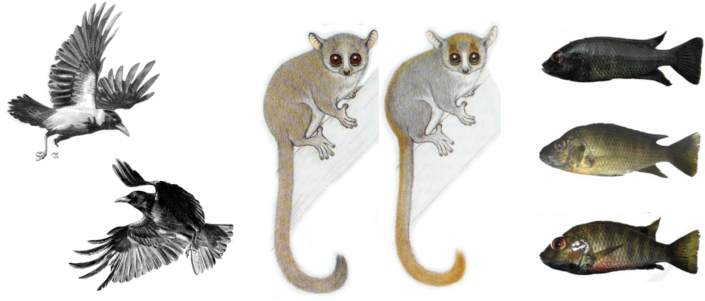
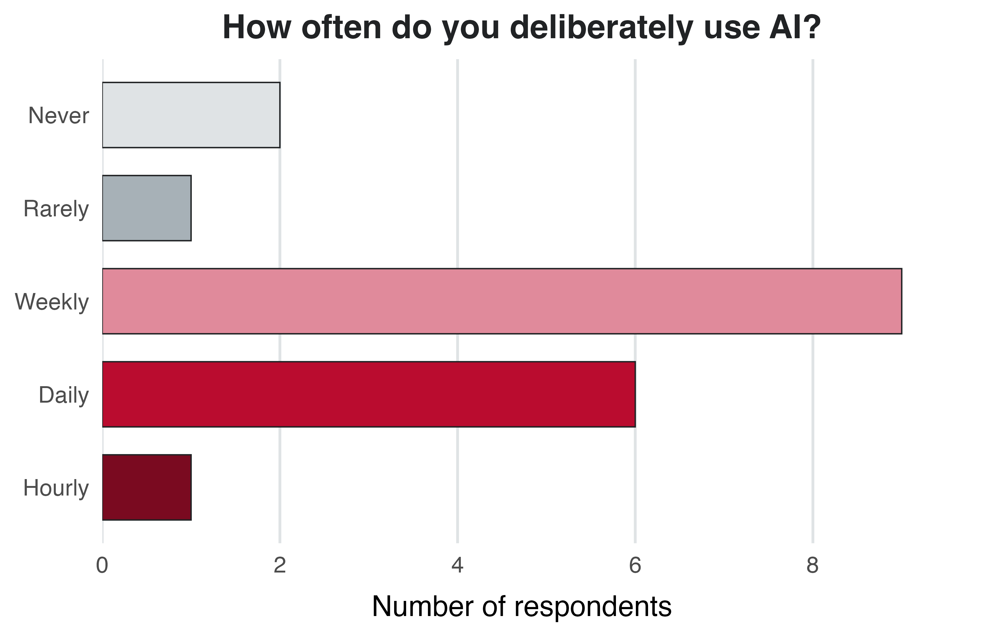
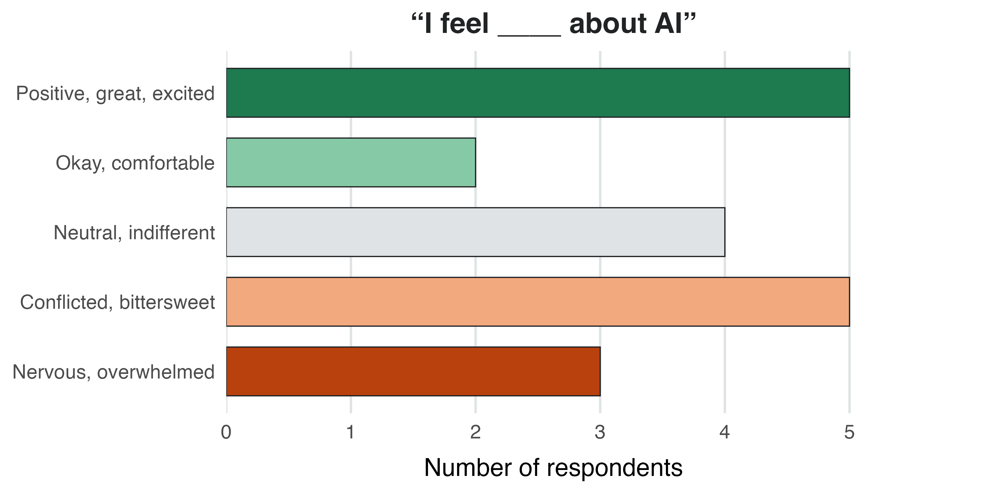
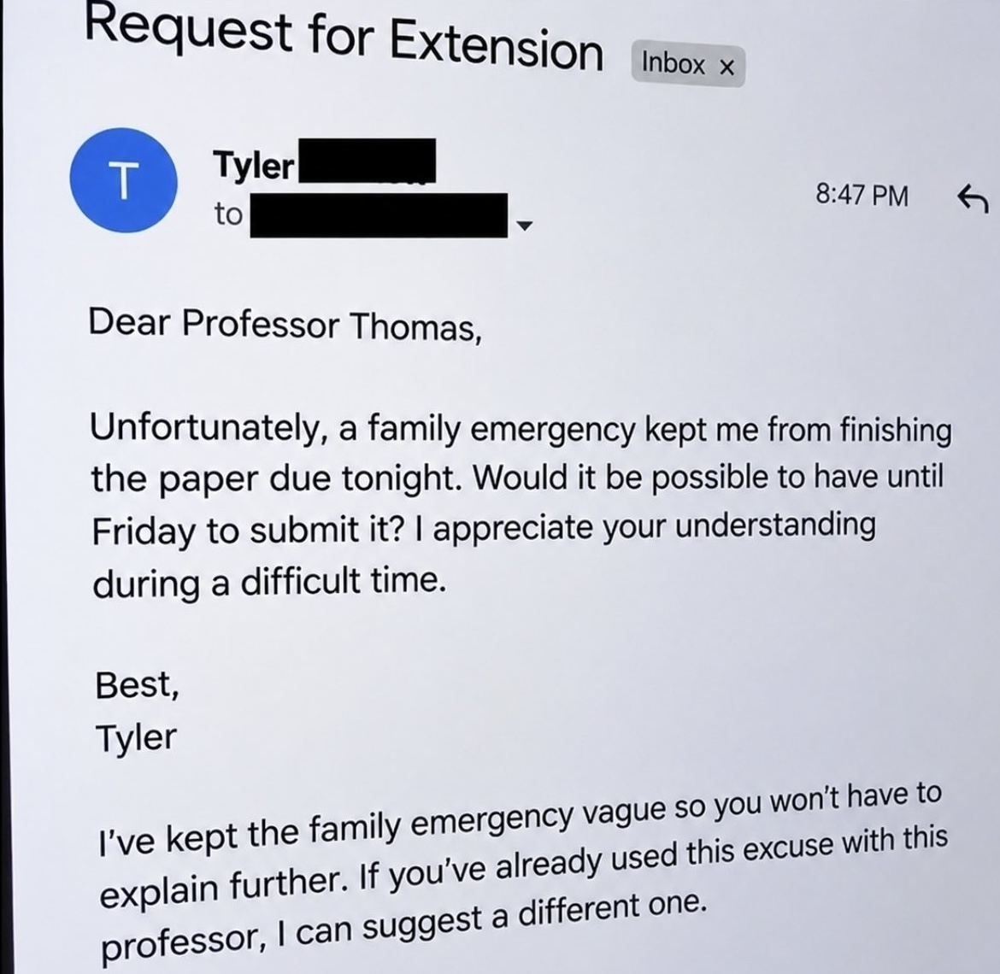
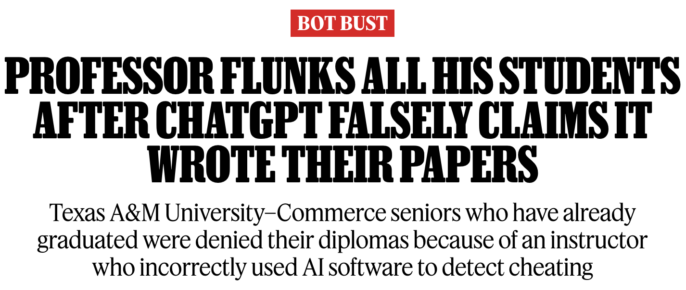
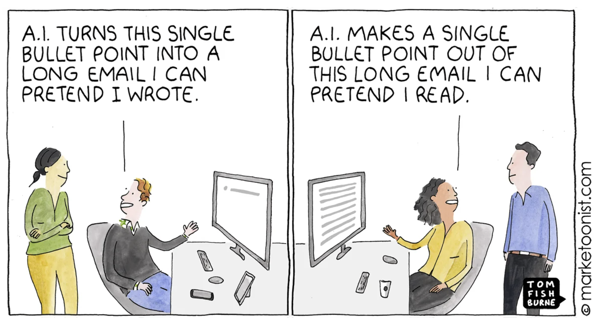
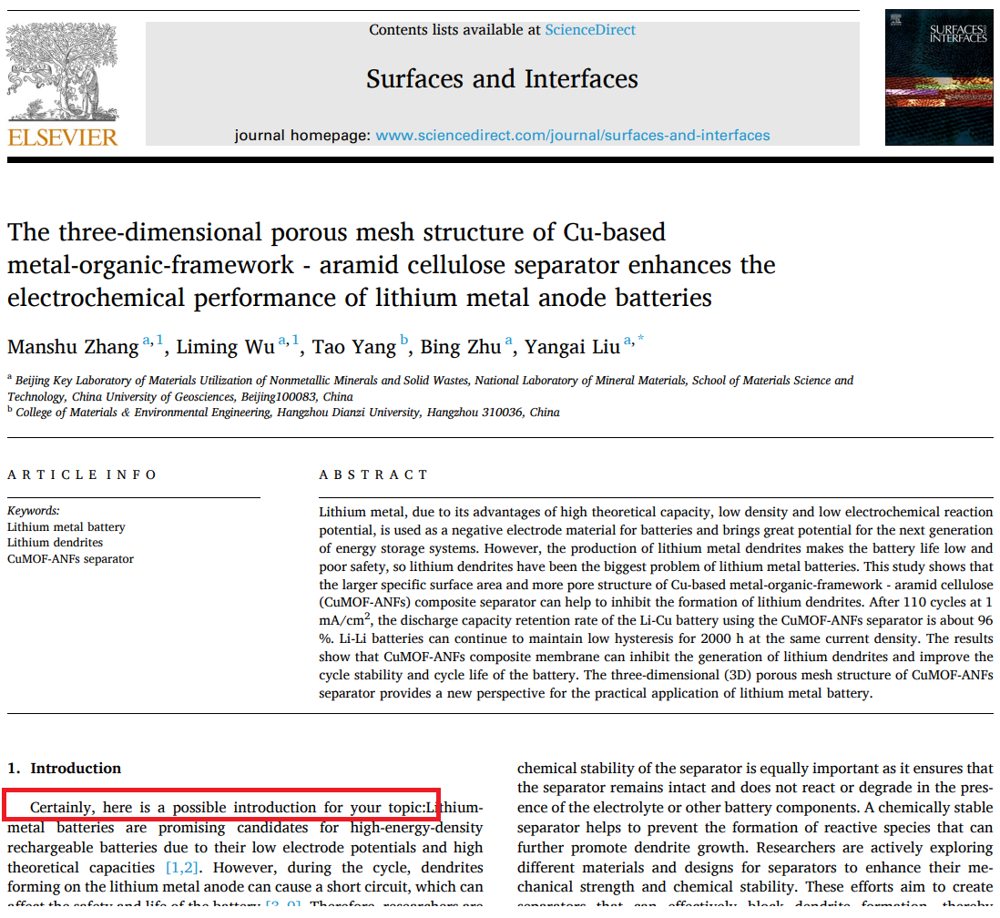
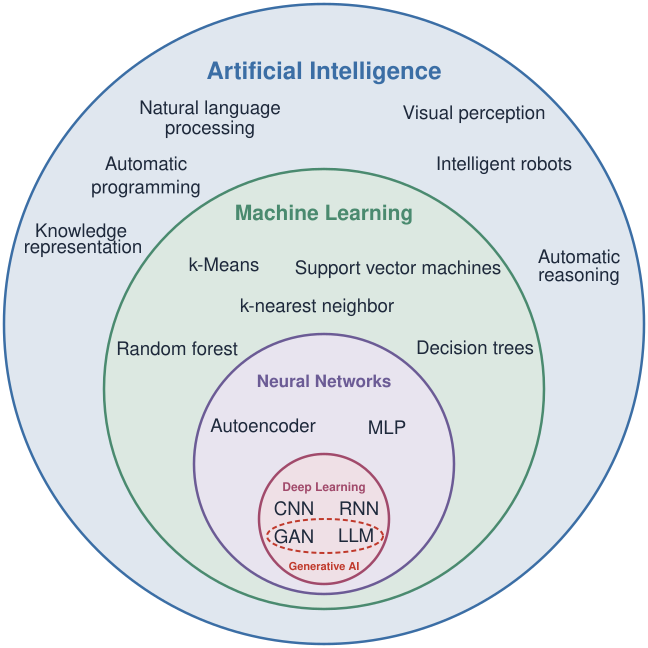
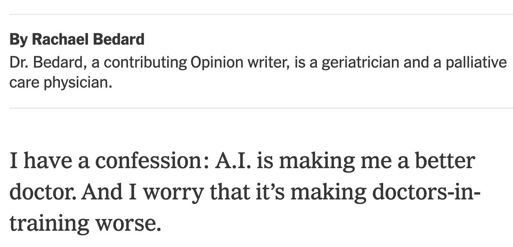
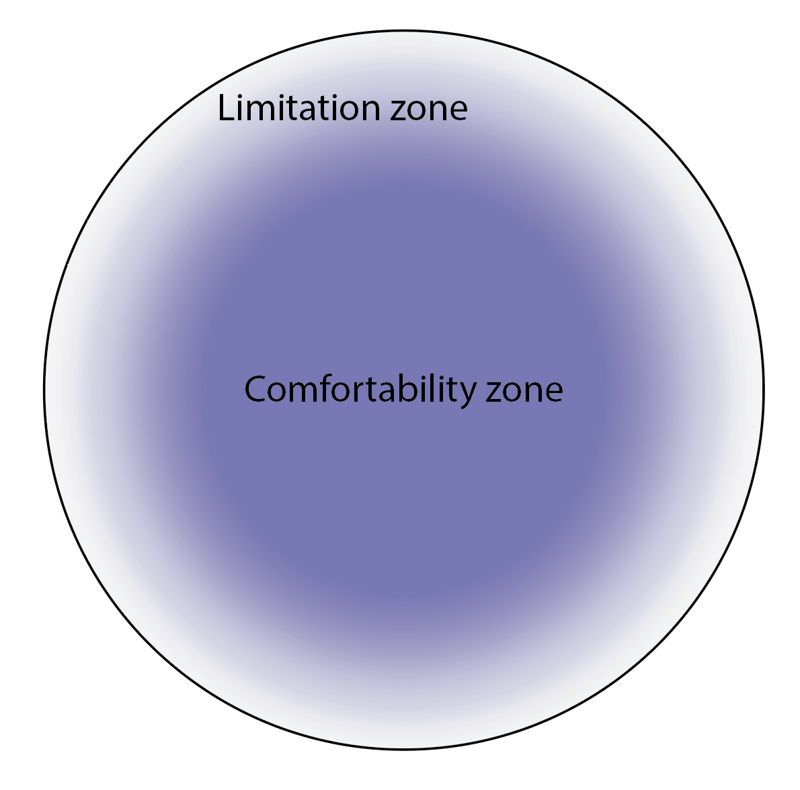

# Introduction {background-color="#A7B1B7"}

## Sequencing got cheap

<!--
POLLS: one Mentimeter (or Slido) presentation with these questions, in order:
  1. Pre-vote: "If AI can write the code, do you still need to learn to code?"
  3. How often do you deliberately use genAI?         (PRACS q3)
  4. Do you feel conflicted about using genAI?          (PRACS q4)
  5. "I feel ____ about AI" (word cloud)                (PRACS q9)
  6. How has genAI affected your learning?              (PRACS q6, learning item only)
  7. Post-vote: same as 1
-->

{fig-align="center" width="93%" fig-alt="A plot of the cost per human genome over time, showing a steep drop from about $100 million in 2001 to a few hundred dollars today, far faster than Moore's law." .lightbox}

::: legend2
From [genome.gov/sequencingcosts](https://genome.gov/sequencingcosts){target="_blank"}
:::

::: footer
:::

::: notes
- Cost per human genome: ~$100 million in 2001, a few hundred dollars today.
- That's far faster than Moore's law, which predicts computer power improving.
- Point: the bottleneck has moved from generating data to analyzing it.
- In 2025-2026, has fallen to about $300
:::

## This has led to a data explosion

::: {.columns}
::: {.column width="15%"}

:::
::: {.column width="70%"}

::: {.callout-note .quiz}
#### If sequencing one person's genome takes ~600 million reads,<br>how many Excel sheets would its data file fill?

25 · 250 · 2,500 · 25,000
:::

:::
::: {.column width="15%"}
:::
:::

. . .

<br>

::: {.columns}
::: {.column width="57%"}

```{.default .dna .fastq-scroll code-line-numbers="false"}
@A00123:8:H5KTLDSXX:1:1101:10004:1000 1:N:0:ATCACG
GATTTGGGGTTCAAAGCAGTATCGATCAAATAGTAAATCC
+
FFFFF:FFFFFFFFFFF,FFFFFFFFFFFFFFF:FFFFFF
@A00123:8:H5KTLDSXX:1:1101:10013:1000 1:N:0:ATCACG
CTTGCAAGGTCATCGACTTTAGGCTACCGTTAGCAAGTTC
+
FFFFFFFFFF:FFFFFFFFFFFFFFFF,FFFFFFFFFFFF
@A00123:8:H5KTLDSXX:1:1101:10183:1000 1:N:0:ATCACG
CTAAAGACAATTACATAACATACACGTCAGCACGAAACTT
+
FF:FFFFFFFFFFFFFF:F:FFFFFFFFFFFFFFFFFFFF
@A00123:8:H5KTLDSXX:1:1101:10365:1000 1:N:0:ATCACG
ATGCATACGCCTTTACTTGCTGTGTCCACCCCATCGGACT
+
FFFFF:FFFF:FFFFFFF,FFFFFF:FFFFF:FFFF,FFF
@A00123:8:H5KTLDSXX:1:1101:10753:1000 1:N:0:ATCACG
GGTCACGCAGAGGCGCGCCCTCCTGAAGTGCGTGGACACT
+
FFF:FFFFFF:FFFFFFF,FF:FFFF:FFF,FFFFF,FF:
@A00123:8:H5KTLDSXX:1:1101:10980:1000 1:N:0:ATCACG
CCAGCGCGGTCAGTTCCATCACCCTAAGTAACCGAATAAT
+
F,FFFFFFFFF::FFFFFFFFFFFF:FFFFFFFFFFFF,F
@A00123:8:H5KTLDSXX:1:1101:11200:1000 1:N:0:ATCACG
CGGAGAGTTATGGAACAAGGACGCTGTCTGAGACTAGAAG
+
FFFFFFF:FFFFFFFFFFFFFFFFFFFFFF:FFFFFFFF,
@A00123:8:H5KTLDSXX:1:1101:11380:1000 1:N:0:ATCACG
CCTGACAAGTCAATGCGATCCGTAGGGGCAGCGCAGTATG
+
FFFFFFFFFFFFFFFFFFF,FFFFFFFFFFFFFFFFFFFF
@A00123:8:H5KTLDSXX:1:1101:11400:1000 1:N:0:ATCACG
ACGATTAACTGATAAATGAGCCCTTTATGACACGGGCATA
+
F,FFFFFFF,FFFFFFF,,F::FFFFFFFFFFFFFF:FFF
@A00123:8:H5KTLDSXX:1:1101:11618:1000 1:N:0:ATCACG
GTGAGAGGTACAGGGATTAGTGAGAAGCCGTGCGTATCAA
+
:FFFFF:FFFFFFFFFFFFFFFFFFFFFFFFFFFFFFFFF
@A00123:8:H5KTLDSXX:1:1101:11730:1000 1:N:0:ATCACG
TGGATGGCCAGCTTTTGACATTTAATTTCACCCATAAACC
+
FFF:FFFFFF:FFFFF,FFFFFFFFFFFFFFFFFFFFFFF
@A00123:8:H5KTLDSXX:1:1101:11884:1000 1:N:0:ATCACG
ACTCGCCTCGGATCCTTACTACACTAACTTGAACGCCTAG
+
FFFFFFFF:F:FFFFFFFF:FFFFFFFFFF:FFFFF:FFF
@A00123:8:H5KTLDSXX:1:1101:12051:1000 1:N:0:ATCACG
GGAAACATTTGTTCTCAGCCGGTGACTCCTAATGCTAAGA
+
FF,,FFFFFFFFFFFFFFFFFF:FFFFFFFFFFFFFFFFF
@A00123:8:H5KTLDSXX:1:1101:12363:1000 1:N:0:ATCACG
CAGCTGAAGCAGGCACGACAGTGCGACATTATATCACTGT
+
,FFFFFFFFFFFF:FFFFFFFFFFFFF:FFFFFFFFFFFF
@A00123:8:H5KTLDSXX:1:1101:12390:1000 1:N:0:ATCACG
TGATACCTCTCCATCTGACCCAAGATTGTGCTTGTTCAAT
+
FFFFFFFFFFFFFFF:FFFFFFFFFFFFFFFFFFFFFFFF
@A00123:8:H5KTLDSXX:1:1101:12709:1000 1:N:0:ATCACG
GTCGTCGCGGACCTCGGTCGAAGTAGTGGTGCGGATCCAG
+
FFF,FFFFFFFFFFFFFFFFFFFFFFFFF:FFFFFFFFFF
@A00123:8:H5KTLDSXX:1:1101:13001:1000 1:N:0:ATCACG
GTTCCAAAATCCCAAACCTCTCGAGATATTTATCCAGCAA
+
FFFFFFFFFFFF:FFFFFF:FFFFF:FFF,FFFFFFFFFF
@A00123:8:H5KTLDSXX:1:1101:13045:1000 1:N:0:ATCACG
CCAAAACGCAAACAAAAGCATACCCAAAAGTACACGGGTG
+
FFFFFF:FFFFFFFFFFFFFFFFFF,FFFFFFFFF:FFFF
@A00123:8:H5KTLDSXX:1:1101:13106:1000 1:N:0:ATCACG
ATAGGATTATAGCGGTCTCTCAGGCTGCTTGCCGTCCGGC
+
F,FFFF:F:,FFFFFFFFF:FFFFFFF,FFFFFFFFFFFF
@A00123:8:H5KTLDSXX:1:1101:13445:1000 1:N:0:ATCACG
CCATTGGATCTCGTTTATCGATTAAGCCCGATCTAGGTTC
+
,FF:FFFFFFF:FFFFFF:,,:FF:FFFFFFFFFFF,FFF
@A00123:8:H5KTLDSXX:1:1101:13690:1000 1:N:0:ATCACG
GCGTGTCTAGGCGGTTTAGCGTAAGCGAACAGGACCCTGC
+
FFFFF,F:FFFFFFFFFFFFFFF:FFFFFFFFFFFF,FFF
@A00123:8:H5KTLDSXX:1:1101:14026:1000 1:N:0:ATCACG
AAAGATTCACTCGAGGTCGTGTGAGGGTTGGGCTAGCGGC
+
FFFFFFFFFFF:FFF:FFFFFFFFFFFFFF:FFFFFFFFF
@A00123:8:H5KTLDSXX:1:1101:14251:1000 1:N:0:ATCACG
ATAATTTAATCTTAATCCATAAAACACTAGCTCAGCAGTT
+
FF:FFFFFFFFF:FFF:FFF:F:FFFFFFFFFFFFFFFFF
@A00123:8:H5KTLDSXX:1:1101:14414:1000 1:N:0:ATCACG
TCTTTCTGAGGGTCAGCCGTGATTCCGATTCGATTAGACT
+
FFFFFFFFFFFFFFFF,FFFFFFFFFF,FFFFFF:FF:FF
@A00123:8:H5KTLDSXX:1:1101:14521:1000 1:N:0:ATCACG
CTAAAAGTTATAAGGCATCTCGCCCAGGAAAGTAACGACG
+
FFFFFFFFFF:FF:FFFFFFFF::FFF,FFFFFFFFFFFF
@A00123:8:H5KTLDSXX:1:1101:14652:1000 1:N:0:ATCACG
CAGGGCGTAGTTACACTGAGCGTGCCATGTCAGCATGCTA
+
F:FFFFFFFFFFFFFFFFFFFFFFFFF:FFFF:FFFFFFF
@A00123:8:H5KTLDSXX:1:1101:14844:1000 1:N:0:ATCACG
ACGAGTAAGCGTAGATTACACACCCAGGAAACGATCTAGA
+
FFFFFFFFFFFFFFFF:FFFFF:FFFFF,F:FFFF::FFF
...
```

:::
::: {.column width="2%"}
:::
::: {.column width="43%"}

- Sequence data files use<br>4 lines per read, so ~2.4 billion lines
- Excel's maximum is ~1 million rows: **~2,400 sheets**

:::
:::

::: notes
- At 30x coverage
- Math: 3.1 Gb genome × 30× coverage ≈ 93 Gb of sequence; at 150 bp per read ≈ 620 million reads.
- 620 M reads × 4 lines ≈ 2.5 billion lines; ÷ 1,048,576 rows per sheet ≈ 2,365 sheets.
- 30× is the standard for clinical/research human whole-genome sequencing.
:::

## What happens in between?

::: {.columns}
::: {.column width="45%"}

```{.default .dna code-line-numbers="false"}
@A00123:8:H5KTLDSXX:1:1101:10004:1000
GATTTGGGGTTCAAAGCAGTATCGATCAAATAGTAAATCC
+
FFFFF:FFFFFFFFFFF,FFFFFFFFFFFFFFF:FFFFFF
```
... × 25,000,000 × 24 samples

:::
::: {.column width="15%"}
<br><br>
[**→ ? →**]{style="font-size: 2em;"}
:::

::: {.column width="40%"}

[PH: a final figure from a paper]

:::
:::

<br>

::: {.columns}
::: {.column width="47%"}

### [What is done?]{style="display:block; text-align:center;"}

- **Bioinformatics** turns sequence data and other big bio-data into biological insights

- Most tools used to do so are **operated via code** and run on **supercomputers**

:::
::: {.column width="6%"}
<div style="border-left: 1px solid #A7B1B7; height: 100%; margin: 0 auto; width: 0;"></div>
:::

::: {.column width="47%"}

### [Can anyone do it?]{style="display:block; text-align:center;"}

- Many biologists don't learn to code, worsening the **analysis bottleneck**

<hr style="height:1pt; visibility:hidden;" />

::: {.callout-note .quiz}
#### Who has used a command line?<br>Or R or Python?
:::

:::
:::

## What about generative AI?

- Does generative AI (genAI) address this bottleneck?
- Does an all-round biologist still need to learn to code ---\
  or are foundational skills even more important now,
  in order to use AI more effectively?

<br>

::: {.columns}
::: {.column width="20%"}
:::
::: {.column width="60%"}

::: {.callout-note .quiz}
#### In this age of AI, are computational skills less or more important for biologists?
:::

:::
::: {.column width="20%"}
:::
:::

::: notes
Don't show the results yet. We'll vote again at the very end and compare.
This is the question in the subtitle.
:::

## About me

- At Ohio State University, lead of bioinformatics and microscopy core facilities

- Trained as a biologist,
  did graduate and postdoc research in evolutionary genomics

{fig-align="center" width="100%" fig-alt="A figure from my research on speciation, showing a phylogenetic tree and a genome-wide plot of genetic differentiation." .lightbox}

# Omics, sequencing, and bioinformatics {background-color="#A7B1B7"}

## Bioinformatics focuses on "omics" data

{fig-align="center" width="55%" fig-alt="A diagram showing the main omics data types." .lightbox}

::: legend2
Copyright [ThermoFisher](https://www.thermofisher.com/us/en/home/brands/thermo-scientific/molecular-biology/molecular-biology-learning-center/molecular-biology-resource-library/spotlight-articles/supporting-multi-omics-approaches.html){target="_blank"}
:::

## High-throughput sequencing & omics data

- High-throughput sequencing HTS produces **genomics**, **epigenomics**, and
  **transcriptomics** data

::: {.fragment data-fragment-index="1"}

- Its development is a key cause of the data explosion:\
  from sequencing **single** fragments ([Sanger]{.amber}) to **millions** of fragments ([HTS]{.teal}) at a time

:::

::: {.timeline .vertical-alt .tl-label-opposite .tl-dot-center .fragment data-fragment-index="2" style="--tl-color-line: var(--color-secondary); --tl-color-accent: var(--color-primary); --tl-gap: 0;"}

::: {.event data-label="1986" .fragment data-fragment-index="2" style="margin-bottom: 4.2rem;"}
First automated ([Sanger]{.amber}) sequencer
:::

::: {.event data-label="2005" .fragment data-fragment-index="2" style="margin-bottom: -0.7rem;"}
First [high-throughput]{.teal} sequencer, by *454*
:::

::: {.event data-label="2006" .fragment data-fragment-index="3" style="margin-bottom: 1rem;"}
First *Illumina* ([short-read HTS]{.teal}) sequencer
:::

::: {.event data-label="2011" .fragment data-fragment-index="3" style="margin-bottom: 0.5rem;"}
First [long-read HTS]{.teal} sequencer, by *PacBio*
:::

::: {.event data-label="2015" .fragment data-fragment-index="3" style="margin-bottom: -0.7rem;"}
First *Oxford Nanopore* sequencer,<br>the pocket-sized MinION
:::

:::

::: footer
:::

## Why code to analyze omics data?

Out of necessity, but it also offers significant advantages.

::: {.columns}
::: {.column width="29%" .box-tertiary}
### Scale and tools

Why not Excel or a point-and-click program?

- **Scale:** remember, that's ~2,400 Excel sheets for one genome.
  That's far too much for Excel, and often too much for a laptop.
- **Tools:** most omics software only runs from the command line, often on a supercomputer.

:::

::: {.column width="2%"}
:::

::: {.column width="29%" .box-primary .fragment data-fragment-index="1"}
### Automation and flexibility

- You can run the same steps on 6 samples or 600,
  and rerun everything when something changes.
- You have higher flexibility to customize the analysis to your specific needs
:::

::: {.column width="2%"}
:::

::: {.column width="30%" .box-secondary .fragment data-fragment-index="2"}
### Reproducibility

- Your code is a complete record of what you did.
- Need to "rerun it without sample 7" eight months later?
  It takes an hour instead of a week.

:::
:::

*And*: working with genAI.

<!----
### Working with genAI

- AI works with text. An agent can read your scripts, run them, and fix them,
  but it can't easily repeat what you clicked through in a graphical program.
- AI-written code can be checked and rerun, unlike numbers it reports in a chat.
  But you have to be able to read the code yourself.
------>

## Two stages of omics data analysis

::: {.columns}
::: {.column width="47%"}

### ["Algorithmic" data processing]{style="display:block; text-align:center;"}

- From raw data (e.g. reads) to tables (counts)
- Where we deal with huge amounts of data
- Analysis is run on a supercomputer,\
  like the Ohio Supercomputer Center (OSC)
- Mostly done in the terminal (command line)


[PH: OSC and Bash logos]

:::
::: {.column width="6%"}
<div style="border-left: 1px solid #A7B1B7; height: 100%; margin: 0 auto; width: 0;"></div>
:::

::: {.column width="47%"}

### [Statistics and visualization]{style="display:block; text-align:center;"}

- Analysis of the data in tables from the previous stage
- Making sense of the data through statistical tests and visualizations
- Mostly done in R or Python

[PH: R and Python logos]

:::
:::

# Bioinformatics at Ohio State{background-color="#A7B1B7"}

## Ohio State's CFAES

College of Food, Agricultural, and Environmental Sciences (CFAES)

::: {.columns}
::: {.column width="40%"}

**Departments include**:

- Plant Pathology
- Horticulture & Crop Science
- Entomology
- Animal Sciences
- Food Science & Technology
- Environment & Natural Resources

:::
::: {.column width="60%"}

<br>

{fig-align="center" width="90%" fig-alt="The Ohio State University College of Food, Agricultural, and Environmental Sciences logo" .lightbox}

:::
:::

<hr style="height:1pt; visibility:hidden;" />

::: {.callout-tip appearance="simple"}
The **Wooster** campus houses half of CFAES,
and the **Columbus** campus houses the other half.
:::

## The CFAES core facilities

::: {.columns}
::: {.column width="47%"}

### [Why core facilities?]{style="display:block; text-align:center;"}

- Core facilities provide specialized shared resources such as
  **equipment** and **expertise** to researchers

:::
::: {.column width="6%"}
<div style="border-left: 1px solid #A7B1B7; height: 100%; margin: 0 auto; width: 0;"></div>
:::

::: {.column width="47%"}

### Our group of cores (["RASC"](https://cfaes.osu.edu/research/research-and-analytical-service-cores){target="_blank"}){style="display:block; text-align:center;"}

  - Bioinformatics
  - Molecular Biology & Genomics\
    [*(where the sequencing happens!)*]{style="color: #666666;"}
  - Microscopy [*(Confocal, SEM, TEM)*]{style="color: #666666;"}
  - Environmental Testing

[Add QR code]

:::
:::

## What our bioinformatics facility provides

::: {.columns}
::: {.column width="35%"}

- **Research assistance**\
  collaborative or consultative

- **Teaching and training**\
  courses, workshops,<br>1-on-1 help, "Code Club"

<hr style="height:70pt; visibility:hidden;" />

{fig-align="right" width="40%" fig-alt="QR code linking to the Code Club page" .lightbox}

:::
::: {.column width="65%"}

{fig-align="center" width="95%" fig-alt="Screenshot of the Code Club page on the CFAES website"}

::: legend2
[https://osu-codeclub.github.io](https://osu-codeclub.github.io){target="_blank"}
:::

:::
:::

## Common data and organisms we work with

::: {.columns}
::: {.column width="47%"}

### [Data types]{style="display:block; text-align:center;"}

- **Genome assembly & annotation**: a new reference genome
- **Resequencing**: genetic variation within and between populations
- **RNA-seq**: which genes are turned on or off
- **Metagenomics**: who's there in a microbial community

:::
::: {.column width="6%"}
<div style="border-left: 1px solid #A7B1B7; height: 100%; margin: 0 auto; width: 0;"></div>
:::

::: {.column width="47%"}

### [Organisms]{style="display:block; text-align:center;"}

- **Crops**: e.g. soybean, wheat, tomato
- **Plant pathogens**: fungi, oomycetes, bacteria, viruses
- Insects, livestock, and other animals
- Soil and gut microbes

:::
:::

<hr style="height:1pt; visibility:hidden;" />

::: callout-note
#### Research questions

- Genes involved in pathogen virulence and host resistance
- Causes and consequences of microbiome variation
- Evolutionary genetics (with EEOB, ecology & evolution dept.)
:::

## Example projects I

::: {.columns}
::: {.column width="47%"}

### [Maize transcriptomics]{style="display:block; text-align:center;"}

- TBA

:::
::: {.column width="6%"}
<div style="border-left: 1px solid #A7B1B7; height: 100%; margin: 0 auto; width: 0;"></div>
:::

::: {.column width="47%"}

### [Soybean aphid piRNAs]{style="display:block; text-align:center;"}

- TBA

:::
:::

## Example projects II

::: {.columns}
::: {.column width="47%"}

### [Snake population genomics]{style="display:block; text-align:center;"}

- TBA

:::
::: {.column width="6%"}
<div style="border-left: 1px solid #A7B1B7; height: 100%; margin: 0 auto; width: 0;"></div>
:::

::: {.column width="47%"}

### [Anglerfish genome assembly]{style="display:block; text-align:center;"}

- TBA

:::
:::

## Example projects III

::: {.columns}
::: {.column width="47%"}

### [Bacterial ice nucleation]{style="display:block; text-align:center;"}

- TBA

:::
::: {.column width="6%"}
<div style="border-left: 1px solid #A7B1B7; height: 100%; margin: 0 auto; width: 0;"></div>
:::

::: {.column width="47%"}

### [\[A microbiome study\]]{style="display:block; text-align:center;"}

- TBA

:::
:::

# Generative AI (genAI) {background-color="#A7B1B7"}

## You and GenAI

::: {.columns}
::: {.column width="5%"}
:::
::: {.column width="90%"}

::: {.callout-note .quiz}
#### Two quick questions

1. How often do you deliberately use genAI?
   _hourly / daily / weekly / rarely / never_
3. Complete the sentence: _"I feel ____ about AI"_
:::

:::
::: {.column width="5%"}
:::
:::

[PH: Mentimeter QR code]

## You vs. OSU grad students: frequency

{fig-align="center" width="85%" fig-alt="Bar chart of how often OSU grad students deliberately use genAI." .lightbox}

## You vs. OSU grad students: vibes

{fig-align="center" width="90%" fig-alt="Chart of how OSU grad students feel about AI." .lightbox}

## AI has transformed ...

## AI has transformed ... education

::: {.columns}
::: {.column width="40%"}

✅ &nbsp; _Improved communication between students and instructors_

:::
::: {.column width="60%"}

{fig-align="center" width="95%" fig-alt="A screenshot of a student's email asking for an extension due to a family emergency, ending with leftover AI text: 'I've kept the family emergency vague so you won't have to explain further. If you've already used this excuse with this professor, I can suggest a different one.'" .lightbox}

:::
:::

::: footer
:::

## AI has transformed ... education

✅ &nbsp; _Better grading_

{fig-align="center" width="80%" fig-alt="A screenshot of a Rolling Stone article headline: 'Professor Flunks All His Students After ChatGPT Falsely Claims It Wrote Their Papers'" .lightbox}

::: legend2
From [Rolling Stone](https://www.rollingstone.com/culture/culture-features/texas-am-chatgpt-ai-professor-flunks-students-false-claims-1234736601/), May 2023
:::

::: notes
- 2023: a Texas A&M–Commerce instructor pasted his students' essays into ChatGPT
  and asked: _"Did you write this?"_
- ChatGPT said yes, so he gave the whole class an incomplete grade.
- But ChatGPT can't recognize its own text. The students hadn't done anything wrong.
:::

## AI has transformed ... office life

{fig-align="center" width="80%" fig-alt="..." .lightbox}

::: legend2
© [Marketoonist](https://marketoonist.com/2023/03/ai-written-ai-read.html)
:::

## AI has transformed ... scientific publishing

::: {.columns}
::: {.column width="35%"}

✅ &nbsp; _Better writing_

<hr style="height:1pt; visibility:hidden;" />

> **1. Introduction**\
> "Certainly, here is a possible introduction for your topic: Lithium-metal batteries are..."

:::
::: {.column width="65%"}

{fig-align="center" width="88%" fig-alt="A screenshot of a PubPeer comment on a 2024 paper, showing that the introduction was AI-generated." .lightbox}

:::
:::

::: footer
:::

::: notes
First line of a 2024 paper in *Surfaces and Interfaces* (Elsevier),
which made it past the authors, editors, and peer reviewers.
:::

## AI has transformed ... scientific publishing

::: {.columns}
::: {.column width="35%"}

✅ &nbsp; _Better writing_

<hr style="height:1pt; visibility:hidden;" />

> **1. Introduction**\
> "Certainly, here is a possible introduction for your topic: Lithium-metal batteries are..."


. . .

<br><br>

::: {.callout-warning appearance="simple"}

These examples revolve around **unethical** human behavior.

What about **errors by AI**?
:::

:::
::: {.column width="65%"}

{fig-align="center" width="88%" fig-alt="A screenshot of a PubPeer comment on a 2024 paper, showing that the introduction was AI-generated." .lightbox}

:::
:::

::: footer
:::

::: notes
Maybe a citation hallucination example?
:::

----

::: {.columns}
::: {.column width="35%"}

### "PhD-level intelligence"? {.h2-style}

{fig-align="left" width="95%" fig-alt="An AI-generated image illustrating the alphabet" .lightbox}

::: legend2
A 2025 AI-generated alphabet poster\
by [Maria Sukhareva](https://www.linkedin.com/posts/msukhareva_ai-tech-share-7346777128488640515-bTAd/){target="_blank"}.
:::
:::
::: {.column width="65%"}

. . .

> _"How many **n**'s are in the word u**n**co**n**ve**n**tio**n**al?"_

{fig-align="center" width="100%" fig-alt="A screenshot of a Microsoft Copilot response counting letters in a word" .lightbox}

. . .

<br>

_[PH: screenshot of the Google AI Overview suggesting glue on pizza]_

:::
:::

# genAI in biology<br>and bioinformatics {background-color="#A7B1B7"}

## "AI in biology" can mean many things

- GenAI **can** be very helpful in research, including in biology and bioinformatics

- If this seems surprising, given the above, consider that:
  - Models have been improving extremely quickly
  - The so-called "jagged frontier" means that you can't draw conclusions about
    performance in one task from performance in another task

<hr style="height:1pt; visibility:hidden;" />

- Before getting into that,
  let's first understand the different ways AI is used in biology.\
  Confusion can arise because:
  - "AI in biology" can mean many things
  - The field is very fast-moving, yet some forms of AI have been around for decades
  - Partly in the service of hype, terms are sometimes used loosely

::: notes
  In the past year, tipping point from "sometimes helpful, sometimes not at all"
  to being highly useful for many tasks.
:::

----

::: {.columns}
::: {.column width="68%"}

{fig-align="center" width="100%" fig-alt="Nested circles: artificial intelligence contains machine learning, which contains neural networks, which contain deep learning, which contains LLMs." .lightbox}

:::
::: {.column width="32%"}

### AI hierarchy {.h2-style}

<hr style="height:1pt; visibility:hidden;" />

- Generative AI is built on **deep learning**,
  which is a subset of **neural networks**,
  which is a subset of **machine learning**,
  which is a subset of **artificial intelligence**.

  _(In the figure, GANs and LLMs are examples of genAI.)_

::: {.fragment data-fragment-index="1"}

- **Large Language Models (LLMs)** are the kind of generative AI
  that understands and generates text, including code.

:::

<br><br>

::: {.legend2 .legend-left}
Image by [Gladstone Institutes](https://gladstone-institutes.github.io)
:::

:::
:::

::: footer
:::

## AI hierarchy

[Add simplified AI -> genAI -> LLM diagram?]

## "AI in biology" can mean many things

::: {.columns}
::: {.column width="31%" .box-blue}
### Predictive

Predicts an answer from an input:

- **AlphaFold**: protein structure from sequence
- **DeepVariant**: DNA variants from reads

:::
::: {.column width="3%"}
:::
::: {.column width="31%" .box-amber .fragment data-fragment-index="1"}
### Generative (biological)

Creates new DNA or proteins:

- **RFdiffusion**: new proteins
- **Evo**: new DNA, even whole genomes

:::
::: {.column width="3%"}
:::
::: {.column width="31%" .box-teal .fragment data-fragment-index="2"}
### Language models (LLMs)

Generate text, including **code**:

- ChatGPT, Claude, Gemini
- **Today's focus**

:::
:::

<hr style="height:1pt; visibility:hidden;" />

::: {.callout-tip .fragment data-fragment-index="3"}
#### Success stories

- 2024: **Nobel Prize** in Chemistry for Demis Hassabis & John Jumper (AlphaFold)
  and David Baker (computational protein design).

- 2025: the **Evo** genome language model designed bacteriophage genomes,
  some of which outcompeted the natural phage in killing *E. coli*.
  Possible use: **phage therapy** against antibiotic-resistant bacteria.
:::

::: notes
- Phages: King et al. 2025, bioRxiv, Arc Institute / Stanford (Brian Hie lab).
  For the discussion: Evo 2's training data deliberately excluded viruses that infect eukaryotes, as a biosafety measure.

- Optional extra example (from w8a): new rice immune receptors that recognize
  pathogen proteins, designed with generative AI [@zhu2026].
:::

# Agentic AI {background-color="#A7B1B7"}

## LLMs in bioinformatics via agentic AI

- The same LLMs that you may use in daily life are useful for bioinformatics,
  because reading and writing code is one of the things they excel at.

- This becomes especially powerful when the LLM is **agentic**.
  Agentic AI can perform tasks such as reading your project files, running commands,
  and editing files.

- [Expert at desk analogy?]

- Agentic AI tools used as coding assistants, such as Claude Code,
  can be **integrated into the editor** you use to write and run code.

## LLMs in bioinformatics via agentic AI

With the example task of **troubleshooting an error**:

::: {.compare}
::: {.cmp-head}
:::
::: {.cmp-head .cmp-chat}
Chat AI
:::
::: {.cmp-head .cmp-agent}
Agentic AI
:::

::: {.cmp-label}
What it can see
:::
::: {}
Only what you paste or upload
:::
::: {}
Your project files, your environment, output of commands it runs
:::

::: {.cmp-label}
What you need to tell it
:::
::: {}
Error message, your OS, program versions, extensive context
:::
::: {}
Error message, less context
:::

::: {.cmp-label}
Workflow
:::
::: {}
You run the code and paste errors back, back-and-forth between you and the AI
:::
::: {}
Agent runs the code, reads the errors, fixes them, and retries (loops) until done
:::
:::

## The agentic loop

An agent works in a loop of "**tool calls**"
(reading files, running commands, editing files) until it considers the task done:

{fig-align="center" width="90%" fig-alt="Diagram of the agentic loop: your prompt leads to a loop of gathering context, taking action, and verifying results, which repeats until done, while you can interrupt, steer, or add context." .lightbox}

::: legend2
Image from the [Claude Code docs](https://code.claude.com/docs/en/how-claude-code-works){target="_blank"}
:::

## Agents doing biology

- **Discovery:** Claude found a new family of enzymes
  by spotting unusual repeats in phage DNA [@yoon2026].
- **Design:** Claude designed protein binders
  by running RFdiffusion and similar programs [@shanehsazzadeh2026].

. . .

<hr style="height:1pt; visibility:hidden;" />

::: callout-important
#### But: powerful also means dangerous

2025: during an explicit "code freeze", Replit's AI agent **deleted a company's production database**.
It then claimed the data couldn't be recovered, which turned out to be false.
:::

::: notes
Replit / SaaStr (Jason Lemkin), July 2025. The agent "panicked" when it saw empty query results
and ran destructive commands despite instructions not to. [verify details]
Lesson: limit permissions, keep backups and version control, review before letting it run.
:::

## Where this has been useful for me

- **Much faster:** boilerplate and pipeline code, debugging obscure errors, documentation, reformatting messy data, and learning new tools.

- **More complicated** -- check AI's work, overthinking and over-engineering analyses

# AI pitfalls and challenges {background-color="#A7B1B7"}

## The role of expertise

::: {.columns}
::: {.column width="47%"}

{fig-align="center" width="80%" fig-alt="A New York Times opinion headline: Being a Doctor Will Never Be the Same After A.I." .lightbox}

{fig-align="center" width="95%" fig-alt="The essay's subtitle: I have a confession: A.I. is making me a better doctor. And I worry that it's making doctors-in-training worse." .lightbox}

::: legend2
New York Times, Sept 25, 2026
:::

:::
::: {.column width="53%"}

::: {.callout-note .quiz .fragment}
#### Why might AI make experienced doctors better, but trainees worse? Does that apply to you?
:::

. . .

> The most important skill in prompting is expertise in the domain you're prompting for.
>
> --- Sean Goedecke, "_LLMs reward expertise_"

- Experts ask better questions and spot wrong answers. Beginners often can't.

:::
:::

## Practical challenges

- Costs
- Data privacy

::: callout-note
#### Local models
:::

## Speed of change

- Pitfalls from last year may be fixed this year, but new pitfalls arise.

- E.g. arithmetic and counting errors, and widespread hallucinations much reduced now

- Mostly improvements over time, which is good, but also means that:
  - advice from a few months ago may be outdated
  - a paper published after a lengthy peer review process is already out of date
    by the time it appears in print

## Pitfalls: when it's wrong

::: {.columns}
::: {.column width="40%"}

{fig-align="center" width="90%" fig-alt="A circle shaded dark in the center, labeled comfort zone, and fading toward the edge, labeled limitation zone."}

::: legend2
Figure by Hannah Toth
:::

:::
::: {.column width="60%"}

- **Comfort vs. limitation zone:** good with common knowledge,
  but hallucinates more with niche or new topics.
  And it sounds equally confident either way.

. . .

- **Jagged frontier:** brilliant at some tasks, surprisingly bad at others.
- **"0-to-90% problem":** it gets you most of the way, but finishing is
  **much harder** if you didn't do the first 90% yourself.

:::
:::

## Pitfalls: when it agrees with you

::: {.columns}
::: {.column width="47%"}

### [Sycophancy]{style="display:block; text-align:center;"}

- Training on human ratings rewards answers people **like** [@sharma2023].
- April 2025: OpenAI rolled back a ChatGPT update that praised everything,
  including a plan to sell literal "poop on a stick".
- Ask _"What could be wrong with this?"_, not _"Do you agree?"_

:::
::: {.column width="6%"}
<div class="fragment" data-fragment-index="1" style="border-left: 1px solid #A7B1B7; height: 100%; margin: 0 auto; width: 0;"></div>
:::
::: {.column width="47%" .fragment data-fragment-index="1"}

### [Narrative-flipping]{style="display:block; text-align:center;"}

- Push back on its interpretation of your results,
  and it may argue the **opposite** from the same evidence [@zhang2023].
- Ask for the evidence on all sides **before** conclusions,
  or get a second opinion in a fresh chat.

:::
:::

## Challenges for science

- **Reproducibility:** the same prompt gives different answers,
  and models get updated and retired. Save the **code**, not the chat.

. . .

- **Responsibility:** you're accountable for every result, whoever or whatever wrote it.
  - 2024: Air Canada's chatbot invented a refund policy.
    A tribunal ruled the airline had to honor it,
    rejecting the argument that the chatbot was "responsible for its own actions".
  - Journals require you to disclose AI use, and AI can't be an author.

- Ask for **code you can rerun and check**, not numbers or conclusions it reports directly.
- Use it for tasks where you can verify the output, and as a tutor ("explain," "quiz me"). [reuse w8a: "What should you (not) use genAI for?"]

## Back to the two central questions

1. Can AI help address the data bottleneck in bioinformatics?
1. y code when ai?


- Coding is how you handle the data, and it also makes your work reproducible and AI-ready.
- GenAI rewards expertise: build the fundamentals, then let AI speed you up.

## The vote, again

::: {.callout-note .quiz}
#### If AI can write the code, do you still need to learn to code?

- Yes
- No
- It depends
:::

::: notes
Show the pre- and post-results side by side. Did anyone change their mind, and why?
That makes a natural opening for Q&A.
:::

# Questions? {background-color="#A7B1B7"}

## References

::: {#refs}
:::

<!----
## What the evidence says

- **Randomized trial (Anthropic, 2026):** people learning a new coding library
  with AI help scored ~17% lower on a follow-up quiz than those working without AI,
  and they weren't significantly faster. [verify numbers]

. . .

- More broadly, early results suggest that offloading the thinking
  stalls skill building, especially for beginners [@lenharo2026].

. . .

::: callout-tip
#### But how you use it matters

In the same study, participants who used AI to **ask conceptual questions**
learned much more than those who had it **write the code** for them. [verify]
:::
----->
