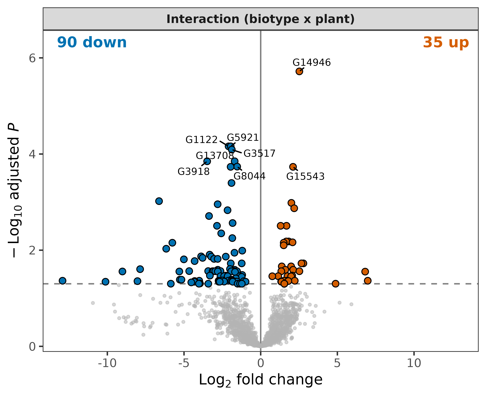
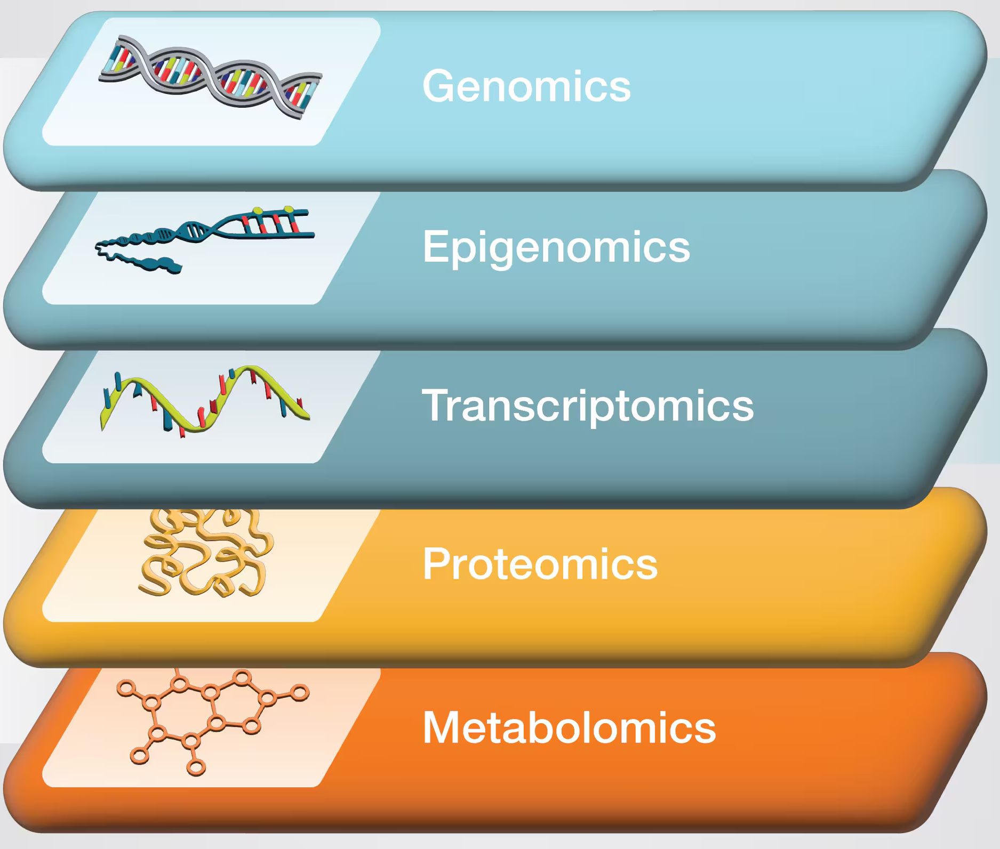
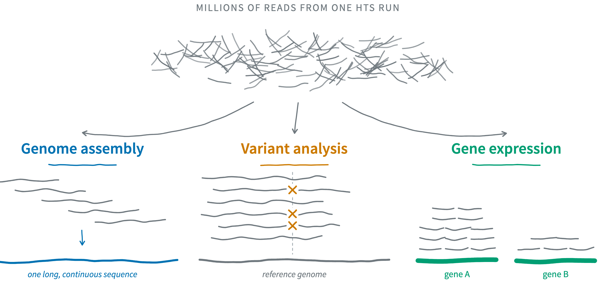
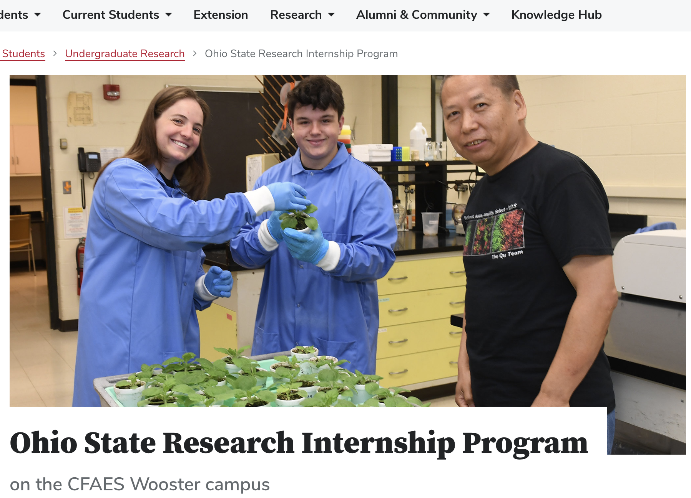
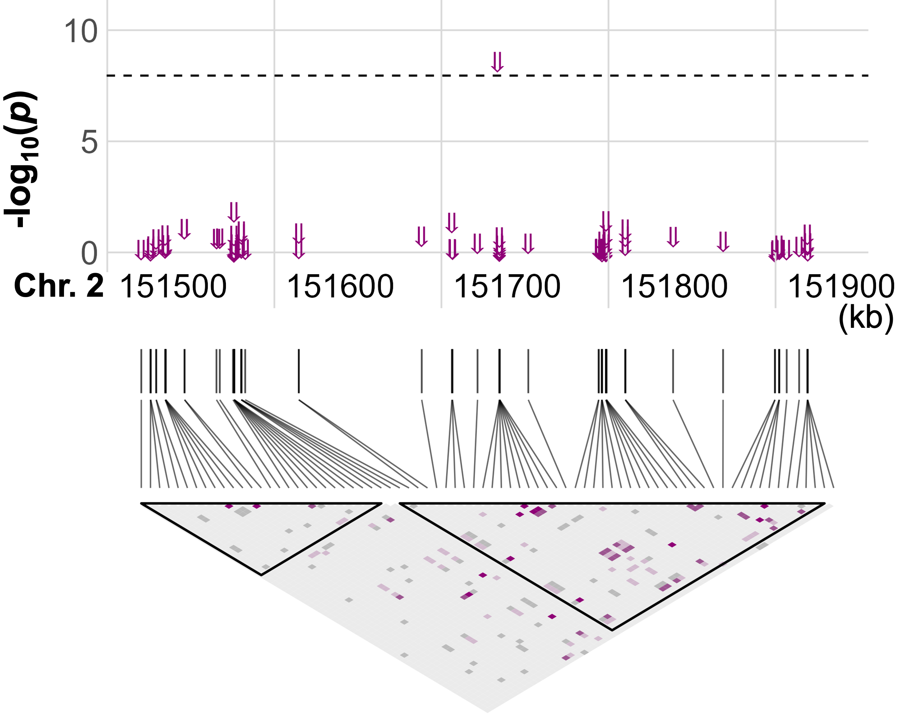
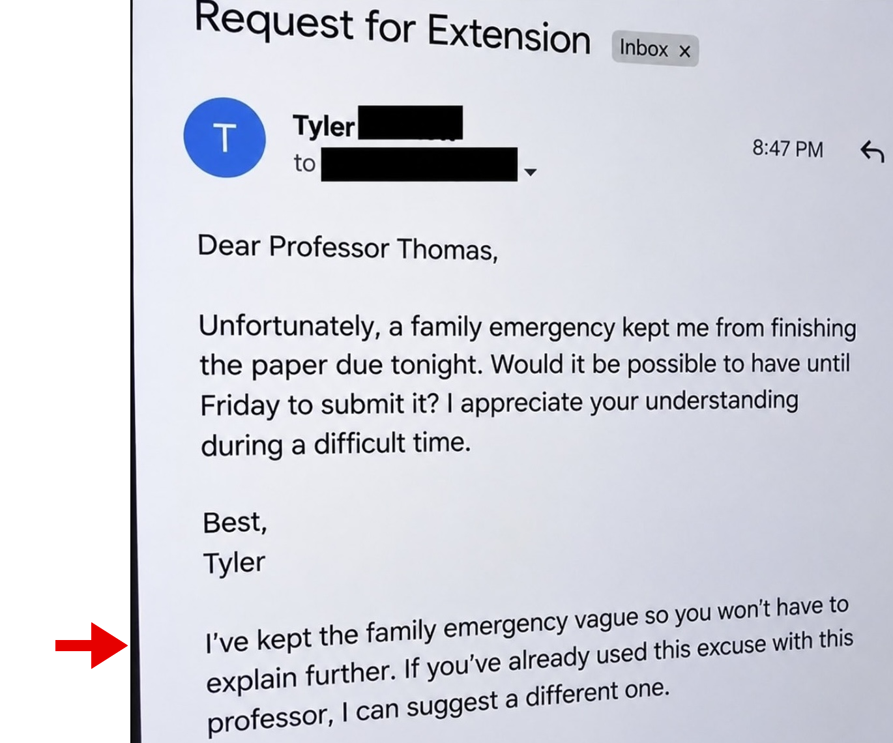
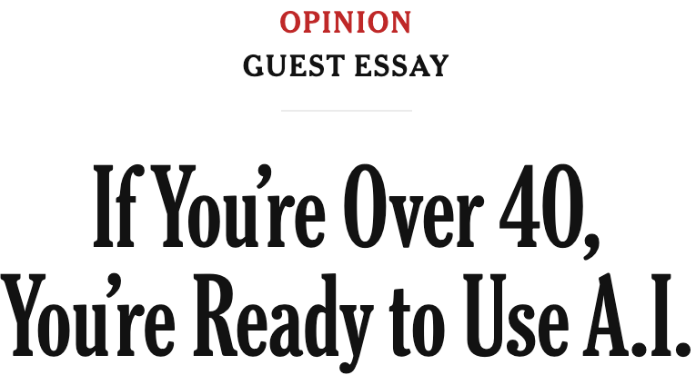

# Introduction {background-color="#A7B1B7"}

## Sequencing has become *much* cheaper

{fig-align="center" width="93%" fig-alt="A plot of the cost per human genome over time, showing a steep drop from about $100 million in 2001 to a few hundred dollars today, far faster than Moore's law." .lightbox}

::: legend2
From [genome.gov/sequencingcosts](https://genome.gov/sequencingcosts){target="_blank"}
:::

::: footer
:::

::: notes
- Note log-scale on y-axis
- Drop is far faster than Moore's law, which predicts computer power improving
  (number of transistors on a microchip doubles approximately every two years)
- In 2025-2026, has fallen to about $300
:::

## This has led to a data explosion

If sequencing one person's genome takes **~600 million sequence "reads"**,\
how many Excel sheets would its data file fill?

. . .

<hr style="height:1pt; visibility:hidden;" />

```{.default .dna .fastq-scroll code-line-numbers="false"}
@A00123:8:H5KTLDSXX:1:1101:10004:1000 1:N:0:ATCACG
GATTTGGGGTTCAAAGCAGTATCGATCAAATAGTAAATCCAAGCCCAATAAACCACTCTGACTGGCCGAATAGGGATATAGGCAACGACATGTGCGGCGACCCTTGCGACAGTGACGCTTTCGCCGTTGCCTAAACCTATTTGAAGGAGT
+
FFFFF:FFFFFFFFFFF,FFFFFFFFFFFFFFF:FFFFFFFFFF,FFFFFFFFF:::FFFF,FFFFFFF,FFF:FFF::FFFFFFFFFFFFFFFFFFFFFFFFFFFFFFFFFFFFFFFFFFFFFFFFFFFFFFFFFFFF:FFF:FFFFFF
@A00123:8:H5KTLDSXX:1:1101:10013:1000 1:N:0:ATCACG
CTTGCAAGGTCATCGACTTTAGGCTACCGTTAGCAAGTTCTCCGCAAGAATCAACAACTACAATGGCGCGTCGTGAATAACGCGACGGCTGAGACGAACGGCGCGTGAATGAAGCGCTTAAACAGCTCAGGAGCCAGTCCCCTACGTCGC
+
FFFFFFFFFF:FFFFFFFFFFFFFFFF,FFFFFFFFFFFFFFFFFFFFFFFFFF:FFF,F:F,F:FFFFFFFFFFFF:FFFFFFFFFFFFFFFFFF:F:FFFFFFFFFFFF:FFFFFFFFFFFFFFFFFFFFFFFFFFFFF:FFFFFFF,
@A00123:8:H5KTLDSXX:1:1101:10183:1000 1:N:0:ATCACG
CTAAAGACAATTACATAACATACACGTCAGCACGAAACTTGTTTCTTGCGTCGTAGCGGGACCCTCCATTGTTACTTATTAGGTTCTCGTTATGTCTCATAATCTCAGTGCTGGTGTGATAAGCAAACCACCCTACTGGCACGAAGTTCA
+
FF:FFFFFFFFFFFFFF:F:FFFFFFFFFFFFFFFFFFFFFFFFFFFFFFFFFFFFFFFFFFFFFF:FFFFFF:FFFFFFFFFFFFFFFFFFFFFFFFFFFFFFFF,FFFFFFFF:FFFFFFF,FFFFFFFFF:FFFFFFF:FFFFFFFF
@A00123:8:H5KTLDSXX:1:1101:10365:1000 1:N:0:ATCACG
ATGCATACGCCTTTACTTGCTGTGTCCACCCCATCGGACTGACATCTTTGTGAACCGACCCACATTTGACGGTACGCTACCGCAACGGTATGTGTTAATGGAACAGACTTGCTTATGTGGACGTTGTATAGGGATATTACGTTACGCGTT
+
FFFFF:FFFF:FFFFFFF,FFFFFF:FFFFF:FFFF,FFFF,FFFFFF,:FFFFFFFF,FFF:FFFFFF:FFFFF,FFFFFFFFFFFFFFFFFFFF,FFFFFFFFFFFFFF:FFFFFFFFFFFFFF:,FFFFFFF:FFFFFFFFFFFFF:
@A00123:8:H5KTLDSXX:1:1101:10753:1000 1:N:0:ATCACG
GGTCACGCAGAGGCGCGCCCTCCTGAAGTGCGTGGACACTCCTGTGATGCATGGTGTGCTTACTGGGATGAATGCGCCGCAAGTAGCAGGTCCCGGCGTGGATACCTGATAGATGGTGACTAGCATGTACAAGTAACCTTGTCTATTGAG
+
FFF:FFFFFF:FFFFFFF,FF:FFFF:FFF,FFFFF,FF:FFFF,F:FFF::FFFF,FF,FFFFFFFFFFF,,FFFFFFFFFFFFFFFFFFFFF:FFFF,FFFFFFFFFFFFFFFFFFFFFFFFFFFFFFFF:FFFFFFFFF:FFFF:F:
@A00123:8:H5KTLDSXX:1:1101:10980:1000 1:N:0:ATCACG
CCAGCGCGGTCAGTTCCATCACCCTAAGTAACCGAATAATAGGGACCTCAGGAGCTAGACGGGGACCTACAACTTTGCGGGAACCAAGTTTTTGCAGTAGTGACTAACGCCGGGAATTCCTCGATATATAGTTTGATAGCTGATACTTAT
+
F,FFFFFFFFF::FFFFFFFFFFFF:FFFFFFFFFFFF,FFFFFFFFFFF:FFFFFFFF:FFFFFFF,F,FFFFFFFFFFFFF,FFFF:FF:FFFF:FFF,FFFF,FFF:FFFFFFFFFFF:FFFF:FFFFFFFFFFF:,:FFFFF:FFF
@A00123:8:H5KTLDSXX:1:1101:11200:1000 1:N:0:ATCACG
CGGAGAGTTATGGAACAAGGACGCTGTCTGAGACTAGAAGCCAGAAGCTCCCCTATGCTGTCCGTCGTTGTTCCCGATGAAGACGTCTACTGATATGCTAGCAGAGCCAGTCTTAAAGCCTAGCGAACTTAATACCGTAGCTCAGAATTA
+
FFFFFFF:FFFFFFFFFFFFFFFFFFFFFF:FFFFFFFF,F,FFFFFFFFFFFFFFFFFFFFFFFFF:F,FFFFFFFFFFFFFF,FF:FFFFFFFFFFFFFFFFFF,F,:FFFFF:FFFFFFFFFFF:FFFFFFFFFFFFFFF,F:FFFF
@A00123:8:H5KTLDSXX:1:1101:11380:1000 1:N:0:ATCACG
CCTGACAAGTCAATGCGATCCGTAGGGGCAGCGCAGTATGTAGGAGGCCGCACCCTAGGTCAAGTTTTACGATTGCCCTAACGCCGCGGAGCGCGACCCGAAAAGCTATGGTCTGTAACTTTTCGCGGGTCGAGCTAGTCCAAGTTCCGG
+
FFFFFFFFFFFFFFFFFFF,FFFFFFFFFFFFFFFFFFFFFF,FFFFFFFFFFFFFFFFFFFFFFFFFFFFFFFFFF,FFFFFFFFFFFFF:FFFFFFFFFFFFFFFFFFFFF,FFFFFFFFFFFFFFFFFFFFFFFFF,FF:FFFFFFF
@A00123:8:H5KTLDSXX:1:1101:11400:1000 1:N:0:ATCACG
ACGATTAACTGATAAATGAGCCCTTTATGACACGGGCATAGTCCGGCGGCTGTGGGATTGCGAGAGTGTCCGGCACCACCAATGTACACTTTCGGGAACACTCATTCGAAGAGGTTCTGCAGCTGCAGGCCTTGATACCTGCAGTCTGGG
+
F,FFFFFFF,FFFFFFF,,F::FFFFFFFFFFFFFF:FFFFFFFFFFFF:FFFF:FF:FF,FF:FFFFFFFFFF:FF:FFFFFFFFFFFFFFFFFFFFFFFFFFF,FFFFFF:FFF:FF:FFFF,FF,FF,FFFFFFFFFFFFF:FFFFF
@A00123:8:H5KTLDSXX:1:1101:11618:1000 1:N:0:ATCACG
GTGAGAGGTACAGGGATTAGTGAGAAGCCGTGCGTATCAAACATTCCACGCGGCGCCTGGACTTAGTGTTCGTCTCCGCTATTCTCGCGATGACAGTAACCTCGGACCATCCTCGGTTGGGGTTATGCGGTACCAGTGCCGCTCTGGTTT
+
:FFFFF:FFFFFFFFFFFFFFFFFFFFFFFFFFFFFFFFFFFFFF:FFFFF:FFFFFFFFFFFFFFFFFFF,FFFF:FFFFFFFFFFF,FFFFFFFFFFFFFFFFFFFFFFFFFF:FFF:F:FFFFFFFFFFFFF,FF,FFFFF:FFFF,
@A00123:8:H5KTLDSXX:1:1101:11730:1000 1:N:0:ATCACG
TGGATGGCCAGCTTTTGACATTTAATTTCACCCATAAACCTCGTTCTAGCAAGCTCTGGAAAGTGGACACTTTAAAGAGTAGTTACCTCCGGGTCACTGTGTAGGCTCTACGATGTGTGTCGGCTGCTGGTCGTGTGACCATCTGATTCG
+
FFF:FFFFFF:FFFFF,FFFFFFFFFFFFFFFFFFFFFFFFFFFF,FFF:FFFFFFFFFFFFF,FFF:FFFFFFFFFFFFFFFF:F:FFFFFFFFFFFFFFFF,FFFF:FFFFFFFFFFFFFFFFFFFFFFFFFFFFFFFFFFFFFFFFF
@A00123:8:H5KTLDSXX:1:1101:11884:1000 1:N:0:ATCACG
ACTCGCCTCGGATCCTTACTACACTAACTTGAACGCCTAGTCTTCTCCTGCCGTAGATCCTTTTTTTCAACGAGCGCTTAAGGATCTACGATGGATACCGTCCCCAGGCGGGGACTAGCCCCGCTTCGTTTAATGGTTGAATGATCTCTG
+
FFFFFFFF:F:FFFFFFFF:FFFFFFFFFF:FFFFF:FFFFFFFFFFFFFFF:FF,F,:FFFFFFFFFFFFFFFFFFFFFFFFFFFFFFFFFFFFFFFFFFFFF:FFFFFFFFFFFFFFFF:FFFFFFFFFFFFFFFFFFFFFFFFF,FF
@A00123:8:H5KTLDSXX:1:1101:12051:1000 1:N:0:ATCACG
GGAAACATTTGTTCTCAGCCGGTGACTCCTAATGCTAAGAAGCAATGTTTACGAGACCGTAGTCACATATAGCAACACTGGCGCGAAGTGAGATTGATCGCGAACAAACATGTCCATCGCTGGAGAACCATATGGGATAGCGGCTGTCCC
+
FF,,FFFFFFFFFFFFFFFFFF:FFFFFFFFFFFFFFFFFFFFFFF:FFFFFFFFF,FF:FFFF,FFFFFFF:FFFFFFFFFFFFFFFFF:FFFFFFFFFFFFFFFFF,FFFFFFFFFF,FFFFFFFFFF:FF:FFFFFFFFFFFFFFFF
@A00123:8:H5KTLDSXX:1:1101:12363:1000 1:N:0:ATCACG
CAGCTGAAGCAGGCACGACAGTGCGACATTATATCACTGTCGTTTAAGTCTCCATGTTGGTGCAGCAGATGCCACCGACTGCCCGGAGCCTGCTAAACCATAGCCGCGAACCAGAGTAGGGCCTTGCGCCTGGCCATACGCATCGACGGC
+
,FFFFFFFFFFFF:FFFFFFFFFFFFF:FFFFFFFFFFFFF:FFFFFFFFFFFFFFFFFFFFFFFFFFFFFFFFF:,F,FFFFFFFF,FF:FFFFFFFFFFFFFFFF,FFFFFFFFFFFFFFFFFFFFFFFFFFF:F:FFFFFFFFF,F:
@A00123:8:H5KTLDSXX:1:1101:12390:1000 1:N:0:ATCACG
TGATACCTCTCCATCTGACCCAAGATTGTGCTTGTTCAATTCCCCCATATCCGGAATTGGTATATCCAAAGGTGTTTACGTCTATGCATGGAGGGGTACCGTGGTACTCTTGACAGTCACCCACATAGCGGTTAACGTTCTGGCGAGATA
+
FFFFFFFFFFFFFFF:FFFFFFFFFFFFFFFFFFFFFFFFFF:FFFFFFFFF:FFFFFF:FFFFFFFFFFFFFFFFFFF,FFFFFFFFFFFFFFFF,FFFFFFFFFFF:FFFFFFFFFFFFFFFFFFFFFFFFFF:FFFFFFFFFFFF:F
@A00123:8:H5KTLDSXX:1:1101:12709:1000 1:N:0:ATCACG
GTCGTCGCGGACCTCGGTCGAAGTAGTGGTGCGGATCCAGGCATGCGAATGCCCTACTTTTTTAACGAGCAACCGGCATGCAAGGTGTCGTGCCTACCCCACAGATGAAAAAATTTAGTCCAGTAGCTAAGAATCCGCGTGCATCTGCAA
+
FFF,FFFFFFFFFFFFFFFFFFFFFFFFF:FFFFFFFFFFF:FFFFFFFFF,FFFFFFFFFFFFFFFFFFFFFFF:FFFFFFFFF:FFFFFFFFFFF,F:FFFFFFFFFF,FFFFFFFFFFFF,FFFFFFFFF,FFFFFFFFFFFFFFFF
@A00123:8:H5KTLDSXX:1:1101:13001:1000 1:N:0:ATCACG
GTTCCAAAATCCCAAACCTCTCGAGATATTTATCCAGCAAAAGCTGGACTGTGTAACAGGGGAACTCTAGCCATCTCGATAATTCTAATTCCCATGTTCGTGGTCCTGGCCCGGCCGAGTTGTAAATCAACGCGGCAGCAGTACTCGATT
+
FFFFFFFFFFFF:FFFFFF:FFFFF:FFF,FFFFFFFFFFFFF:FFFFFFFFFFFFFFFF,F:FFFFFFFFF:F:FFFFFFFFFF:FFFFFFFFFF:FFFFFFFFF:FFFFFFFFFFFFFFFFFFF,FFFFFFFFFFFFFFFFFFFFFFF
@A00123:8:H5KTLDSXX:1:1101:13045:1000 1:N:0:ATCACG
CCAAAACGCAAACAAAAGCATACCCAAAAGTACACGGGTGCGTTTTTGATAAAAAGAGGAGTTTATCCCTGCGGACAAATAGCGCTCCCCGCACATAGAGACTGGCCAGACGTTGGCGGTCAGCCTGGCGTTTGGTACAGCCGAAAATCA
+
FFFFFF:FFFFFFFFFFFFFFFFFF,FFFFFFFFF:FFFFFF,FFFFFFFFFFFFFFFFFFF:F:FFFFFFFFF:FFFF,FFFFFFFFFFFFFF:FFFFFFFFFFFFFFFFFFFFFFFFFFFFFFFFFF:FFFFFFFF,FFFFFFFFFFF
@A00123:8:H5KTLDSXX:1:1101:13106:1000 1:N:0:ATCACG
ATAGGATTATAGCGGTCTCTCAGGCTGCTTGCCGTCCGGCTACTTCAACTCACTAAATCATTGATCTTGATCGTCAGTGCAAAATCGTGACTGGTGGTCTTCGTGGGTCACTCACTGACTAACTTAAGCGAATTGACTTACGCACCAGCA
+
F,FFFF:F:,FFFFFFFFF:FFFFFFF,FFFFFFFFFFFF,FFFFFFFF:FFFFFFF:FFFFFFFFFFFFFFFFFFFFFFFFFFFFFFFFFFFFFFFFFFFFFF:FFFFFFFFFFFF:FFF:FFFFFFFFFFFFFFF:FFFFFFFFFFFF
@A00123:8:H5KTLDSXX:1:1101:13445:1000 1:N:0:ATCACG
CCATTGGATCTCGTTTATCGATTAAGCCCGATCTAGGTTCGGCGCGTGGCTTCTGGTGTCCCAGCTTCCCTACTTCGTGGATACACGTATGGGGGGATAGCCGGGTTATGTCCGTTAACGCGGGGTGTGTTCCACCGACCTAAATAATAA
+
,FF:FFFFFFF:FFFFFF:,,:FF:FFFFFFFFFFF,FFFFFFFFFFFFFFFFFF,FFF:FFFFFFFFFFFFFFFFFFFFFF::FFFFFFFFFFFFFFFFFF:FFFFFFFFFFFFFFFFFFFFFFFFFFFF,FFFF:FFFFFFFFFFFFF
@A00123:8:H5KTLDSXX:1:1101:13690:1000 1:N:0:ATCACG
GCGTGTCTAGGCGGTTTAGCGTAAGCGAACAGGACCCTGCACTACTTGGCAAGTGCGACACTGACGATCAATCGACCTAGAAGCACTCGGTCATGCGATTGTCCGGTGCACTGGGTATCAGCGATCTCGGTGAAAACCACATCAATTGAG
+
FFFFF,F:FFFFFFFFFFFFFFF:FFFFFFFFFFFF,FFFFFF:F:FFFFFFFFFFFFFFFFFFFFFF:FFFFFFFFFFFFFFF::F,FFFFFFFFFFFF:FFFFFFF,FFF:F:FFFFFFFFFFFFFFFFFFFFFFFFFFF:FFF:FFF
@A00123:8:H5KTLDSXX:1:1101:14026:1000 1:N:0:ATCACG
AAAGATTCACTCGAGGTCGTGTGAGGGTTGGGCTAGCGGCATAGAGCGCCATTACTGTCCGATATGATTCCTCTTCCCAGTGAATTGGCGGAGCGTCTACCGCAAACCGAGAGTTAGCCCGTCATAGCAGCGATAATGGAAGTCTAGTAC
+
FFFFFFFFFFF:FFF:FFFFFFFFFFFFFF:FFFFFFFFFF:FFF:FFFFFFF,,FFFF,,::FFFFFFFFFFFFFFFFFFFFFFF:F:FFFFFFFFFFFF,:FFFFFFFFF,FFFFFFFFFFFFFFFFFF:::FFFFF:FFFFFFFFFF
@A00123:8:H5KTLDSXX:1:1101:14251:1000 1:N:0:ATCACG
ATAATTTAATCTTAATCCATAAAACACTAGCTCAGCAGTTTAATTACTATACGTTGGTCTGACTTAACCTTGTACTCTAGGCAAATGATCTTACGCCCCATGGTGCACCAGATTTATCCTTTTAACGCACCAGACAGGAAATCCGCTGAA
+
FF:FFFFFFFFF:FFF:FFF:F:FFFFFFFFFFFFFFFFFFFFFFFFFFFFFFFFF,FFFFFFFFFFF:FFFFFFFFFFFFFFFFFFFFFFFFFFFFFFF:FFF:FFFFFFFFFF:FFFFFFFF:FFFFFFFFFFFFFFFFFFFFFFFFF
@A00123:8:H5KTLDSXX:1:1101:14414:1000 1:N:0:ATCACG
TCTTTCTGAGGGTCAGCCGTGATTCCGATTCGATTAGACTCATATCCGTGGCACCATTAAGAAGTAAGAGCGCCGGGTAGCCGAAACGGGCGCCAGGTACATAATAATTCTGGGCATCATATGTTCCCGGTCGGTTAATAGTTCGGCATA
+
FFFFFFFFFFFFFFFF,FFFFFFFFFF,FFFFFF:FF:FFFFFFFFFF,FFFFFFFFFFF:FFFFFFF:FFFFFFFFFF:FFFFFFFFFFF:F:F,FFF,FFFFFFFFFFFFFFFFFFFFFF:FF,FFFFFFF,FFFFFFFFFFFFFFFF
@A00123:8:H5KTLDSXX:1:1101:14521:1000 1:N:0:ATCACG
CTAAAAGTTATAAGGCATCTCGCCCAGGAAAGTAACGACGCGTGAATGATACGTAACTAGAGATTTGTGGGCAGGATCAGAGTACAGGCGGGAACCTGCGCTCAGACCTTTCTCCGAGAACTTTGTCTTTGCTAGTTGAAGTGGGGAGTT
+
FFFFFFFFFF:FF:FFFFFFFF::FFF,FFFFFFFFFFFFFFFFFFFFFFFFFFFFFFFF:FF:FFFFFFFF:FFFF:F:FF:FFFFFFFF:FFF:FFFFFFF:FFFFFFFFF:FFF:FF:FFFFFFF:FFF:FFFF:FF:FFFFFFFFF
@A00123:8:H5KTLDSXX:1:1101:14652:1000 1:N:0:ATCACG
CAGGGCGTAGTTACACTGAGCGTGCCATGTCAGCATGCTAAGTATCCACACTTAGTTAAGAGATACTCCAACTATACCACAGATCAAATCACTGTGACGCACGAAGCTCGCTCACATCATAAACAGTTCCCGTTCCACTAGGTACCAAGC
+
F:FFFFFFFFFFFFFFFFFFFFFFFFF:FFFF:FFFFFFFFFFFFFF:FF:FFFFFFFFFFFFFFFFFFFFFFFFFFFFFFFFFFFFFFFFFFFFFFFFFFF::FFFFFFFFFFFFFFF:::FFF,FFFFFFFFFFFFFFF,FFFFFF,F
@A00123:8:H5KTLDSXX:1:1101:14844:1000 1:N:0:ATCACG
ACGAGTAAGCGTAGATTACACACCCAGGAAACGATCTAGACTCGTAATGAGTGCAGAGAATGTAGGCACCGCATCCGGGTGAAGGTTATGTGACTAATCGAACGACTCCAGTCTGTTAGCAACGTGGTTTGCGCGCTGGACGGTCCGCCC
+
FFFFFFFFFFFFFFFF:FFFFF:FFFFF,F:FFFF::FFFFF,FFFFFF,FF,FFF:F::F,FFFFF:F,FFF:FFFFFFFFFFFFFFFFFFFF:,FFFFFFFFFFFFFFFFFFFFFFFFFFFFF,FF:FFFFFFFF:FFFFFFFFFFFF
...
```

<hr style="height:1pt; visibility:hidden;" />

- Sequence data files use 4 lines per read, so ~2.4 billion lines

. . .

- Excel's maximum is ~1 million rows: **~2,300 sheets**

::: notes
- At 30x coverage
- Math: 3.1 Gb genome × 30× coverage ≈ 93 Gb of sequence; at 150 bp per read ≈ 620 million reads.
- 620 M reads × 4 lines ≈ 2.5 billion lines; ÷ 1,048,576 rows per sheet ≈ 2,365 sheets.
- Slide rounds to 600 M reads: 2.4 billion lines ≈ 2,290 sheets, so "~2,300".
- 30× is the standard for clinical/research human whole-genome sequencing.
:::

## What happens in between?

::: {.columns}
::: {.column width="45%"}

```{.default .dna code-line-numbers="false"}
@A00123:8:H5KTLDSXX:1:1101:10004:1000
GATTTGGGGTTCAAAGCAGTATCGATCAAATAGTAAATCC
+
FFFFF:FFFFFFFFFFF,FFFFFFFFFFFFFFF:FFFFFF
```
... × 25,000,000 × 24 samples

:::
::: {.column width="15%"}
<br><br>
[**→ ? →**]{style="font-size: 2em;"}
:::

::: {.column width="40%" .fig-tight}

{fig-align="center" width="85%" fig-alt="A volcano plot showing piRNA expression in aphids on soybean"}

:::
:::

<hr style="height:1pt; visibility:hidden;" />

::: {.columns}
::: {.column width="47%" .fragment data-fragment-index="1"}

### [What is done in between?]{style="display:block; text-align:center;"}

- **Bioinformatics** involves the analysis of sequence data and other big bio-data

- Most tools used to do so are operated via **code** and run on **supercomputers**

:::
::: {.column width="6%" .fragment data-fragment-index="2"}
<div style="border-left: 1px solid #A7B1B7; height: 100%; margin: 0 auto; width: 0;"></div>
:::

::: {.column width="47%" .fragment data-fragment-index="2"}

### [Can anyone do it?]{style="display:block; text-align:center;"}

- Many biologists don't learn to code, worsening the **analysis bottleneck**

- Most of my job is helping biologists do this, or do it for them

:::
:::

::: footer
:::

<!---- Who has used a command line? Or R or Python? ---->

## What about generative AI?

- Does **generative AI** address this bottleneck?
- Do biologists still need to **learn to code** ---\
  or do foundational skills matter even more, to use AI well?

<br>

. . .

::: {.columns}
::: {.column width="10%"}
:::
::: {.column width="80%"}

::: {.callout-note .quiz}
#### In this age of AI, are computational skills less or more important for biologists?
- Less
- More
:::

:::
::: {.column width="10%"}
:::
:::

## About me

- At Ohio State's Wooster campus, lead of **microscopy** and **bioinformatics** core facilities

. . .

- Trained as a biologist, graduate and postdoc research in **evolutionary genomics**

{fig-align="center" width="100%" fig-alt="Illustrations of study organisms from my speciation research: a hooded and a carrion crow, two mouse lemur species, and three cichlid fish."}

::: footer
:::

## The rest of this talk

1. Omics, sequencing, and bioinformatics
2. Bioinformatics at Ohio State
3. AI in biology and bioinformatics

# Omics, sequencing,<br>and bioinformatics {background-color="#A7B1B7"}

## Bioinformatics focuses on "omics" data

{fig-align="center" width="55%" fig-alt="A diagram showing the main omics data types." .lightbox}

::: legend2
Copyright [Thermo Fisher](https://www.thermofisher.com/us/en/home/brands/thermo-scientific/molecular-biology/molecular-biology-learning-center/molecular-biology-resource-library/spotlight-articles/supporting-multi-omics-approaches.html){target="_blank"}
:::

## High-throughput sequencing & omics data

- High-throughput sequencing (HTS) produces **genomics**, **epigenomics**, and
  **transcriptomics** data

::: {.fragment data-fragment-index="1"}

- Its development is a key cause of the data explosion:\
  from sequencing **single** fragments ([Sanger]{.gray}) to **millions** of fragments ([HTS]{.scarlet}) at a time

:::

::: {.timeline .vertical-alt .tl-label-opposite .tl-dot-center .fragment data-fragment-index="2" style="--tl-color-line: var(--color-secondary); --tl-color-accent: var(--color-primary); --tl-gap: 0;"}

::: {.event data-label="1986" .fragment data-fragment-index="2" style="margin-bottom: 4.2rem;"}
First automated ([Sanger]{.gray}) sequencer
:::

::: {.event data-label="2005" .fragment data-fragment-index="2" style="margin-bottom: -0.7rem;"}
First [high-throughput]{.scarlet} sequencer, by *454*
:::

::: {.event data-label="2006" .fragment data-fragment-index="3" style="margin-bottom: 1rem;"}
First *Illumina* ([short-read HTS]{.scarlet}) sequencer
:::

::: {.event data-label="2011" .fragment data-fragment-index="3" style="margin-bottom: 0.5rem;"}
First [long-read HTS]{.scarlet} sequencer, by *PacBio*
:::

::: {.event data-label="2015" .fragment data-fragment-index="3" style="margin-bottom: -0.7rem;"}
First *Oxford Nanopore* sequencer,<br>the pocket-sized MinION
:::

:::

::: footer
:::

----

{.img-wide fig-align="center" fig-alt="Three HTS applications sketched from one starting point. At the top, a dense, unstructured pile of short reads labelled millions of reads from one HTS run, with three arrows fanning down. Left, genome assembly: five reads arranged as a staircase so each overlaps the one above, an arrow, and a single long blue line labelled one long, continuous sequence. Middle, variant analysis: six reads aligned above a grey reference genome line, with an amber cross at the same column in three of the six. Right, gene expression: reads sorted into two stacks, a tall stack over a teal bar labelled gene A and a short stack over a bar labelled gene B."}

::: footer
:::

## Why code to analyze omics data?

Why not Excel or a point-and-click (GUI) program?\
Code is a **necessity** but also offers significant **benefits**

<hr style="height:10pt; visibility:hidden;" />

::: {.columns}
::: {.column width="29%" .box-tertiary .fragment data-fragment-index="1"}
### Necessary due to scale and tools

- Data often **too large** for GUI programs and laptops
- Tools often **only** run from the command line (etc.)

<hr style="height:1pt; visibility:hidden;" />

:::

::: {.column width="2%"}
:::

::: {.column width="29%" .box-primary .fragment data-fragment-index="2"}
### Automation and flexibility

- Code is nearly the same to run **6 vs. 600** samples
- More options to **customize** the analysis
:::

::: {.column width="2%"}
:::

::: {.column width="30%" .box-secondary .fragment data-fragment-index="3"}
### Reproducibility and transparency

- Your code is a complete **record** of what you did
- **Rerunning** everything, say, a year later is much easier

<!---- in full or "without sample 7"  --->

:::
:::

# Bioinformatics at Ohio State{background-color="#A7B1B7"}

## Ohio State's CFAES

Ohio State is divided into 15 colleges, and I work at **CFAES**:\
The College of Food, Agricultural, and Environmental Sciences

::: {.columns}
::: {.column width="40%" .fragment data-fragment-index="1"}

**Departments include**:

- Plant Pathology
- Horticulture & Crop Science
- Entomology
- Animal Sciences
- Food Science & Technology
- Environment & Natural Resources

:::
::: {.column width="60%"}

<hr style="height:60pt; visibility:hidden;" />

{fig-align="center" width="90%" fig-alt="The Ohio State University College of Food, Agricultural, and Environmental Sciences logo"}

:::
:::

<hr style="height:1pt; visibility:hidden;" />

::: {.callout-note appearance="simple" .fragment data-fragment-index="2"}
The **Wooster** campus houses half of CFAES,
and the **Columbus** campus houses the other half
:::

## The CFAES core facilities

::: {.columns}
::: {.column width="47%"}

### [Core facilities]{style="display:block; text-align:center;"}

- Core facilities provide specialized resources like
  **equipment** and **expertise**

- Instead of duplicating expensive equipment and expertise in every lab,
  cores allow researchers to **share** them

:::
::: {.column width="6%" .fragment data-fragment-index="1"}
<div style="border-left: 1px solid #A7B1B7; height: 100%; margin: 0 auto; width: 0;"></div>
:::

::: {.column width="47%" .fragment data-fragment-index="1"}

### [Our group of cores ("RASC")]{style="display:block; text-align:center;"}

  - Bioinformatics
  - Molecular Biology & Genomics\
    [*(where the sequencing happens!)*]{style="color: #666666;"}
  - Microscopy [*(Confocal, SEM, TEM)*]{style="color: #666666;"}
  - Environmental Testing

:::
:::

::: {.columns}
::: {.column width="53%"}

:::
::: {.column width="47%"}

:::
:::

::: {.columns}
::: {.column width="15%"}

:::
::: {.column width="70%"}

::: {.callout-tip .fragment data-fragment-index="2"}
#### Our services are available to you as well
- We also serve other institutions, including the College of Wooster
- User fees can be found on [our website](https://cfaes.osu.edu/research/research-and-analytical-service-cores){target="_blank"}
:::

:::
::: {.column width="15%"}

:::
:::

## What our bioinformatics facility does

::: {.columns}
::: {.column width="36%"}

- **Research assistance**\
  collaborative or consultative

- **Teaching and training**\
  courses, workshops, 1-on-1 help

:::
::: {.column width="2%"}
:::
::: {.column width="62%" .fragment data-fragment-index="1"}

&nbsp;&nbsp; _Our informal weekly [Code Club](https://osu-codeclub.github.io){target="_blank"} event on R is open to anyone_

{fig-align="center" width="90%" fig-alt="Screenshot of the Code Club website"}

::: legend2
[https://osu-codeclub.github.io](https://osu-codeclub.github.io){target="_blank"}
:::

:::
:::

::: footer
:::

## What our bioinformatics facility does

::: {.columns}
::: {.column width="36%"}

- **Research assistance**\
  collaborative or consultative

- **Teaching and training**\
  courses, workshops, 1-on-1 help

<hr style="height:1pt; visibility:hidden;" />

::: {.fragment data-fragment-index="1"}

{fig-align="center" width="65%" fig-alt="The Ohio Supercomputer Center logo"}

:::

::: {.column width="2%"}
:::

:::
::: {.column width="64%"}

&nbsp;&nbsp;&nbsp;&nbsp;&nbsp;&nbsp;&nbsp;_We hosted an intern from the College of Wooster last year_

{fig-align="center" width="90%" fig-alt="Screenshot of the Ohio State Research Internship Program (ORIP) web page"}

::: legend2
[Ohio State Research Internship Program (ORIP)](https://cfaes.osu.edu/current-students/undergraduate-students/undergraduate-research/ohio-state-research-internship-program){target="_blank"}
:::

:::
:::

::: footer
:::

## Example projects I

::: {.columns}
::: {.column width="47%"}

### [Assembly]{style="display:block; text-align:center;"}

- A species of deep-sea anglerfish
- *Phytophthora* oomycetes with varying pathogenicity to soybean
- Austrian pine *transcriptome*

{fig-align="center" width="87%" fig-alt="A photograph of a deep-sea anglerfish, showing its large head, wide mouth, and the bioluminescent lure dangling from its forehead." .lightbox}

::: legend2
Image from Wainwright 2024 [@wainwright2024]
:::

:::
::: {.column width="6%" .fragment data-fragment-index="1"}
<div style="border-left: 1px solid #A7B1B7; height: 100%; margin: 0 auto; width: 0;"></div>
:::

::: {.column width="47%" .fragment data-fragment-index="1"}

### [Variant analysis]{style="display:block; text-align:center;"}

- Population genomics of Brazilian pit vipers
- Loss of ice nucleation genes in bacteria
- Environmental adaptation GWAS of chile peppers

{fig-align="center" width="90%" fig-alt="GWAS result"}

:::
:::

::: footer
:::

## Example projects II

::: {.columns}
::: {.column width="47%"}

### [Transcriptomics]{style="display:block; text-align:center;"}

- Maize response to *Pantoea* infection
- *Aedes* mosquito response to mating
- Soybean aphid piRNA expression

{fig-align="center" width="95%" fig-alt="A volcano plot showing piRNA expression in aphids on soybean"}

:::
::: {.column width="6%" .fragment data-fragment-index="1"}
<div style="border-left: 1px solid #A7B1B7; height: 100%; margin: 0 auto; width: 0;"></div>
:::

::: {.column width="47%" .fragment data-fragment-index="1"}

### [Microbial metagenomics]{style="display:block; text-align:center;"}

- Wastewater treatment biofilms vs. salinity
- Gut microbiome on various bread diets
- Stock plants infected with *Xanthomonas*

{fig-align="center" width="95%" fig-alt="A heatmap showing the relative abundance of different bacterial taxa in stock plants infected with Xanthomonas, with samples on the x-axis and taxa on the y-axis." .lightbox}

:::
:::

::: footer
:::

::: notes
Various bread diets = whole-wheat vs white
:::

# AI in biology<br>and bioinformatics {background-color="#A7B1B7"}

## AI has transformed ... [education]{style="color:white"}

## AI has transformed ... education

::: {.columns}
::: {.column width="33%"}

✅ &nbsp; _Stronger student–instructor_
&nbsp; &nbsp; &nbsp; &nbsp; &nbsp; _trust_

:::
::: {.column width="67%"}

{fig-align="center" width="100%" fig-alt="A screenshot of a student's email asking for an extension due to a family emergency, ending with leftover AI text: 'I've kept the family emergency vague so you won't have to explain further. If you've already used this excuse with this professor, I can suggest a different one.'" .lightbox}

:::
:::

::: footer
:::

## AI has transformed ... education

✅ &nbsp; _Better grading_

{fig-align="center" width="80%" fig-alt="A screenshot of a Rolling Stone article headline: 'Professor Flunks All His Students After ChatGPT Falsely Claims It Wrote Their Papers'" .lightbox}

::: legend2
From [Rolling Stone](https://www.rollingstone.com/culture/culture-features/texas-am-chatgpt-ai-professor-flunks-students-false-claims-1234736601/){target="_blank"}, May 2023
:::

::: notes
- 2023: a Texas A&M–Commerce instructor pasted his students' essays into ChatGPT
  and asked: _"Did you write this?"_
- ChatGPT said yes, so he gave the whole class an incomplete grade.
- But ChatGPT can't recognize its own text, and the students hadn't done anything wrong.
:::

## AI has transformed ... scientific publishing

::: {.columns}
::: {.column width="35%"}

✅ &nbsp; _Making scientific writing less_
&nbsp; &nbsp; &nbsp; &nbsp; &nbsp; &nbsp; _tedious_

<hr style="height:1pt; visibility:hidden;" />

> **1. Introduction**\
> "Certainly, here is a possible introduction for your topic: Lithium-metal batteries are..."

:::
::: {.column width="65%"}

{fig-align="center" width="88%" fig-alt="First page of a 2024 paper in Surfaces and Interfaces, with its introduction's AI-generated opening line boxed in red." .lightbox}

[Zhang et al. 2024, *Surfaces and Interfaces* [@zhang2024]]{style="display:block; text-align:center; font-size:0.6em;"}

:::
:::

::: footer
:::

## AI has transformed ... scientific publishing

::: {.columns}
::: {.column width="35%"}

✅ &nbsp; _Making scientific writing less_
&nbsp; &nbsp; &nbsp; &nbsp; &nbsp; &nbsp; _tedious_

<hr style="height:1pt; visibility:hidden;" />

> **1. Introduction**\
> "Certainly, here is a possible introduction for your topic: Lithium-metal batteries are..."


. . .

<br><br>

::: {.callout-warning appearance="simple"}

These examples are about how **people use** (or misuse) AI.

What about **errors by AI** itself?
:::

:::
::: {.column width="65%"}

{fig-align="center" width="88%" fig-alt="The same paper's first page, now stamped RETRACTED in red."}

[Zhang et al. 2024, *Surfaces and Interfaces* [@zhang2024]]{style="display:block; text-align:center; font-size:0.6em;"}

:::
:::

::: footer
:::

----

::: {.columns}
::: {.column width="35%"}

### "PhD-level intelligence"? {.h2-style}

::: {.fragment data-fragment-index="1"}

{fig-align="left" width="95%" fig-alt="An AI-generated image illustrating the alphabet" .lightbox}

::: legend2
A 2025 [alphabet poster](https://www.linkedin.com/posts/msukhareva_ai-tech-share-7346777128488640515-bTAd/){target="_blank"}.\
"PhD-level": Sam Altman in Aug 2025.
:::

:::

:::
::: {.column width="65%" .fragment data-fragment-index="2"}

{fig-align="center" width="79%" fig-alt="A screenshot of a Microsoft Copilot response counting letters in a word" .lightbox}

. . .

{fig-align="center" width="68%" fig-alt="A screenshot of the Google AI Overview suggesting glue on pizza" .lightbox}

::: legend2
Microsoft Copilot, Oct 2025 · Google AI Overview, May 2024
:::

:::
:::

::: footer
:::

## AI in biology

Yet, genAI **can** be ***very*** helpful in research,
including in biology and bioinformatics

<hr style="height:10pt; visibility:hidden;" />

::: {.columns}
::: {.column width="47%" .fragment data-fragment-index="1"}

### [Despite the blunders]{style="display:block; text-align:center;"}

- Models are improving extremely fast ---\
  slapstick mistakes, and others, are gone
- Skill at one task says little about another
- AI is especially good at code

:::
::: {.column width="6%" .fragment data-fragment-index="2"}
<div style="border-left: 1px solid #A7B1B7; height: 100%; margin: 0 auto; width: 0;"></div>
:::

::: {.column width="47%" .fragment data-fragment-index="2"}

### [The terminology can be confusing]{style="display:block; text-align:center;"}

- "AI in biology" means many things
- Some approaches are decades old
- Terms are used loosely, partly due to hype

:::
:::

----

::: {.columns}
::: {.column width="68%"}

{fig-align="center" width="100%" fig-alt="Nested circles: artificial intelligence contains machine learning, which contains neural networks, which contain deep learning, which contains LLMs."}

:::
::: {.column width="32%"}

### AI hierarchy {.h2-style}

<hr style="height:1pt; visibility:hidden;" />

**LLM = Large Language Model**\
genAI that processes and generates text

<hr style="height:300pt; visibility:hidden;" />

::: {.legend2 .legend-left}
Adapted from [Gladstone Institutes](https://gladstone-institutes.github.io){target="_blank"}
:::

:::
:::

::: footer
:::

::: notes
- k-means, k-nearest neighbors, decision trees and SVMs are from the 50s and 60s
- Random forests are from around 2000
:::

## "AI in biology" can mean many things

::: {.columns}
::: {.column width="31%" .box-tertiary .fragment data-fragment-index="1"}
### Predictive

**Predict from / classify input**

- DNA variants from reads (*DeepVariant*)
- Protein structure from sequence (*AlphaFold*)

:::
::: {.column width="3%"}
:::
::: {.column width="31%" .box-primary .fragment data-fragment-index="2"}
### Generative (bio)

**Create new molecules**

- New proteins (*RFdiffusion*)
- New DNA, even whole genomes (*Evo*)

:::
::: {.column width="3%"}
:::
::: {.column width="31%" .box-secondary .fragment data-fragment-index="3"}
### Generic LLMs

**Generate text**

- Including code,<br>which they excel at
- *ChatGPT*, *Claude*, *Gemini*
- [My main focus here]{.blue}

:::
:::

<hr style="height:1pt; visibility:hidden;" />

::: {.columns .fragment data-fragment-index="4"}
::: {.column width="31%"}
::: {.callout-tip}
#### AlphaFold's Nobel Prize
2024: Nobel Prize in Chemistry for [AlphaFold]{.teal}
(shared with protein design) [@jumper2021]
:::
:::
::: {.column width="3%"}
:::
::: {.column width="31%"}
::: {.callout-tip}
#### Evo's phage genomes
2026: [Evo]{.teal} designed phage genomes
better at killing *E. coli* than the natural phage [@king2026]
:::
:::
::: {.column width="3%"}
:::
::: {.column width="31%"}
::: {.callout-tip}
#### Claude's enzymes
2026: [Claude]{.teal} agents found a new
CRISPR-like enzyme system in phage DNA [@yoon2026]
:::
:::
:::

::: notes
- Nobel 2024: half to Hassabis & Jumper (AlphaFold, structure prediction),
  half to David Baker (computational protein design).

- Phages: Arc Institute / Stanford (Brian Hie lab); published in Science, Aug 2026.
  Evo 1/2 fine-tuned on ~14,500 Microviridae genomes,
  using the tiny lytic phage ΦX174 (~5.4 kb) as a design template.
  ~300 designs synthesized, 16 viable; a few killed faster than ΦX174, and one
  had swapped in a packaging protein from the distant phage G4 (confirmed by cryo-EM).
  Possible use: phage therapy against antibiotic-resistant bacteria.

- Claude / ART (Anthropic, Sept 2026, preprint, not peer reviewed): ~950 Claude Code sessions
  (~21 h, ~210 M tokens) mined protein databases for reverse transcriptases. One agent read the raw DNA
  near an RT in a jumbo phage and noticed the same short sequence repeated: a CRISPR-like array.
  Named ART ("array-associated reverse transcriptases"): RT + partner gene + repeat array.
:::

## Agentic AI: an LLM that takes actions

- LLMs can only spit out text,
  but wrapped in an **agentic** interface, they can take actions

- This makes them vastly more useful: from an "**advisor**" to a "**collaborator**"

. . .

::: {style="text-align: center;"}
_An agentic LLM works in a **loop** of **tool calls**_
_(editing files, running commands) until it's done:_
:::

{fig-align="center" width="90%" fig-alt="Diagram of the agentic loop: your prompt leads to a loop of gathering context, taking action, and verifying results, which repeats until done, while you can interrupt, steer, or add context." .lightbox}

::: legend2
Image from the [Claude Code documentation](https://code.claude.com/docs/en/how-claude-code-works){target="_blank"}
:::

::: footer
:::

## Chat vs. agentic AI: troubleshooting an error

::: {.compare}
::: {.cmp-head}
:::
::: {.cmp-head .cmp-chat}
Chat AI
:::
::: {.cmp-head .cmp-agent}
Agentic AI
:::

::: {.cmp-row .fragment}
::: {.cmp-label}
Where it runs
:::
::: {}
A browser tab or stand-alone app
:::
::: {}
Where you write and run your code
:::
:::

::: {.cmp-row .fragment}
::: {.cmp-label}
What it can see
:::
::: {}
Only what you paste or upload
:::
::: {}
Project files, command outputs, etc.
:::
:::

::: {.cmp-row .fragment}
::: {.cmp-label}
What you need to tell it
:::
::: {}
Error message, your OS, program versions, extensive context
:::
::: {}
Error message, less context
:::
:::

::: {.cmp-row .fragment}
::: {.cmp-label}
Workflow
:::
::: {}
Back-and-forth copy-and-paste
:::
::: {}
Agent tries and retries until done
:::
:::
:::

<br>

. . .

::: {.callout-note}
#### Using this reproducibly and responsibly in bioinformatics

- Never use AI output/results directly:
  let it create and edit [code you can check and rerun]{.blue}

- Make AI use [pre-existing tools]{.blue}, not invent new ones
:::

::: notes
- Analogy: chat AI is an expert you phone and describe things to;
  an agent is an expert sitting at your desk.
:::

## Use cases in bioinformatics

::: {.columns}
::: {.column width="47%"}

### [Easy calls]{style="display:block; text-align:center;"}

[*You can easily check the result*]{style="display:block; text-align:center;"}

- Installs, errors, and software bugs
- File conversions and boilerplate code
- Explaining code, errors, and terse docs
- Proofreading code; polishing plots

:::
::: {.column width="6%"}
<div class="fragment" data-fragment-index="1" style="border-left: 1px solid #A7B1B7; height: 100%; margin: 0 auto; width: 0;"></div>
:::

::: {.column width="47%" .fragment data-fragment-index="1"}

### [Powerful but trickier]{style="display:block; text-align:center;"}

[*Checking the result takes expertise*]{style="display:block; text-align:center;"}

- Selecting tools and parameters
- Running a whole analysis end-to-end
- Interpreting results

:::
:::

<hr style="height:1pt; visibility:hidden;" />

### [The bottom line --- [quality]{.teal} usually goes up; [speed-ups]{.blue} vary:]{style="display:block; text-align:center;" .fragment data-fragment-index="2"}

::: {.columns}
::: {.column width="12%"}

:::
::: {.column width="76%" .fragment data-fragment-index="2"}

| Task                                     | Speed-up        |
| ---------------------------------------- | --------------- |
| Individual tasks                         | Can be manyfold |
| Whole analysis, I know what I want       | Can be manyfold |
| Whole analysis, I don't know what I want | Modest to none  |

: {tbl-colwidths="[65,35]" .striped}

:::
::: {.column width="12%"}
:::
:::

::: footer
:::

## Pitfalls

::: {.columns}
::: {.column width="31%" .box-tertiary}
### Unreliability

- **Hallucinations**\
  Especially on niche topics
- **Jagged frontier**\
  Brilliant at some tasks, terrible at others
- **Confidence ≠ accuracy**

:::
::: {.column width="3%"}
:::
::: {.column width="31%" .box-primary .fragment data-fragment-index="1"}
### Agreeableness

- **Sycophancy**\
  Tells you what you want to hear
- Can argue the *opposite* from the same evidence

:::
::: {.column width="3%"}
:::
::: {.column width="31%" .box-secondary .fragment data-fragment-index="2"}
### Other

- **0-to-90% problem**\
  Last 10% is *much harder*
  if you didn't do the first 90%

- Data privacy and<br>safety guardrails
:::
:::

<br>

. . .

**_This is a moving target:_**\
_some of these pitfalls, and today's best-practice advice, may not hold next year_

::: {.notes}
- Can overcomplicate things and be too detail-oriented

April 2025: OpenAI rolled back a ChatGPT update that praised everything,
including a plan to sell literal "poop on a stick".

Deloitte, Oct 2025: a ~A$440,000 report for Australia's Department of Employment
and Workplace Relations contained fabricated academic references and a made-up quote
from a Federal Court judgment. Spotted by a University of Sydney researcher;
Deloitte refunded the final installment and disclosed it had used GPT-4o.

2024, Air Canada's chatbot invented a refund policy. A tribunal ruled the
airline had to honor it, rejecting the argument that the chatbot was
"responsible for its own actions".
:::

## The role of expertise

::: {.columns}
::: {.column width="47%"}

{fig-align="center" width="80%" fig-alt="A New York Times opinion headline: Being a Doctor Will Never Be the Same After A.I."}

{fig-align="center" width="95%" fig-alt="The essay's subtitle: I have a confession: A.I. is making me a better doctor. And I worry that it's making doctors-in-training worse."}

::: legend2
New York Times, Sept 25, 2026
:::

:::
::: {.column width="53%"}

:::
:::

## The role of expertise

::: {.columns}
::: {.column width="50%"}

{fig-align="center" width="80%" fig-alt="A New York Times opinion headline: If You're Over 40, You're Ready to Use A.I."}

::: legend2
New York Times, July 27, 2026
:::

:::
::: {.column width="50%" .fragment data-fragment-index="1"}

> The most important skill in prompting is expertise in the domain you're prompting for.
>
> --- Sean Goedecke,
> "[_LLMs reward expertise_](https://www.seangoedecke.com/llms-reward-expertise){target="_blank"}"

<br>

::: {.callout-note .fragment data-fragment-index="2"}
#### Why expertise matters

- Experts ask better questions, spot wrong answers,
  and steer AI to better solutions
- Pitfalls hit harder for beginners,\
  e.g. 0-to-90% problem

:::

:::
:::

## Let's repeat the vote

::: {.callout-note .quiz}
#### In this age of AI, are computational skills less or more important for biologists?

- Less
- More
:::

## Back to the two central questions

1. Can AI help address the **analysis bottleneck** in bioinformatics? [Yes]{.teal .fragment data-fragment-index="1"}

2. In this age of AI, are **computational skills** less or more important for biologists?
   []{.amber .fragment data-fragment-index="2"}

<hr style="height:1pt; visibility:hidden;" />

[Some thoughts on the *current* state of affairs:]{.fragment data-fragment-index="3"}

::: {.columns}
::: {.column width="4%"}
:::
::: {.column width="44%" .box-tertiary .fragment data-fragment-index="3"}
### Foundations:<br>more important

- AI can help you more if you use code
- AI acts like an exponent on these skills:
  the more you know, the more it helps
:::
::: {.column width="4%"}
:::
::: {.column width="44%" .box-primary .fragment data-fragment-index="4"}
### Encyclopedic details:<br>less important

- Exact syntax, obscure options, low-level tools: superseded by AI

- "Jack of all trades" now has a leg up: AI can fill in the depth, computationally

:::
::: {.column width="4%"}
:::
:::

::: legend2
<hr style="height:35pt; visibility:hidden;" />
This talks's subtitle was borrowed from Hadley Wickham's talk [*y code when ai?*](https://www.youtube.com/watch?v=oi5mopOO4_Y){target="_blank"}
:::

::: notes
- Subtitle "y code when ai?" borrowed from Hadley Wickham's talk of the same name
:::

# Questions? {background-color="#A7B1B7"}

<br>

::: {.qr-grid}

::: {.qr-cell}
{.nostretch width="170px" fig-alt="QR code linking to the slide deck" style="background:#fff;"}

::: {.qr-legend}
**This slide deck**\
[jelmerp.github.io/cow-talk_2026-11](https://jelmerp.github.io/cow-talk_2026-11/talk.html){target="_blank"}
:::
:::

::: {.qr-cell}
{.nostretch width="170px" fig-alt="QR code linking to the CFAES Research and Analytical Service Cores page"}

::: {.qr-legend}
**CFAES service cores (RASC)**\
Bioinformatics, genomics, microscopy & more
:::
:::

::: {.qr-cell}
{.nostretch width="170px" fig-alt="QR code linking to the Code Club page"}

::: {.qr-legend}
**Code Club**\
Informal R coding sessions
:::
:::

::: {.qr-cell}
{.nostretch width="170px" fig-alt="QR code linking to the ORIP program page"}

::: {.qr-legend}
**ORIP internships**\
Ohio State Research Internship Program (undergraduates)
:::
:::

:::

## References

::: {#refs}
:::
