# Introduction {background-color="#A7B1B7"}

## Sequencing has become *much* cheaper

<!-- TODO: Mentimeter (or Slido) question -->

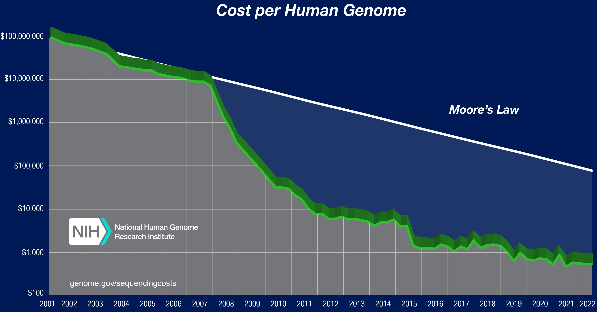{fig-align="center" width="93%" fig-alt="A plot of the cost per human genome over time, showing a steep drop from about $100 million in 2001 to a few hundred dollars today, far faster than Moore's law." .lightbox}

::: legend2
From [genome.gov/sequencingcosts](https://genome.gov/sequencingcosts){target="_blank"}
:::

::: footer
:::

::: notes
- Cost per human genome: ~$100 million in 2001, a few hundred dollars today.
- That's far faster than Moore's law, which predicts computer power improving
  (number of transistors on a microchip doubles approximately every two years)
- In 2025-2026, has fallen to about $300
:::

## This has led to a data explosion

::: {.columns}
::: {.column width="15%"}

:::
::: {.column width="70%"}

::: {.callout-note .quiz}
#### If sequencing one person's genome takes ~600 million reads,<br>how many Excel sheets would its data file fill?

25 · 250 · 2,500 · 25,000
:::

:::
::: {.column width="15%"}
:::
:::

. . .

<br>

::: {.columns}
::: {.column width="57%"}

```{.default .dna .fastq-scroll code-line-numbers="false"}
@A00123:8:H5KTLDSXX:1:1101:10004:1000 1:N:0:ATCACG
GATTTGGGGTTCAAAGCAGTATCGATCAAATAGTAAATCC
+
FFFFF:FFFFFFFFFFF,FFFFFFFFFFFFFFF:FFFFFF
@A00123:8:H5KTLDSXX:1:1101:10013:1000 1:N:0:ATCACG
CTTGCAAGGTCATCGACTTTAGGCTACCGTTAGCAAGTTC
+
FFFFFFFFFF:FFFFFFFFFFFFFFFF,FFFFFFFFFFFF
@A00123:8:H5KTLDSXX:1:1101:10183:1000 1:N:0:ATCACG
CTAAAGACAATTACATAACATACACGTCAGCACGAAACTT
+
FF:FFFFFFFFFFFFFF:F:FFFFFFFFFFFFFFFFFFFF
@A00123:8:H5KTLDSXX:1:1101:10365:1000 1:N:0:ATCACG
ATGCATACGCCTTTACTTGCTGTGTCCACCCCATCGGACT
+
FFFFF:FFFF:FFFFFFF,FFFFFF:FFFFF:FFFF,FFF
@A00123:8:H5KTLDSXX:1:1101:10753:1000 1:N:0:ATCACG
GGTCACGCAGAGGCGCGCCCTCCTGAAGTGCGTGGACACT
+
FFF:FFFFFF:FFFFFFF,FF:FFFF:FFF,FFFFF,FF:
@A00123:8:H5KTLDSXX:1:1101:10980:1000 1:N:0:ATCACG
CCAGCGCGGTCAGTTCCATCACCCTAAGTAACCGAATAAT
+
F,FFFFFFFFF::FFFFFFFFFFFF:FFFFFFFFFFFF,F
@A00123:8:H5KTLDSXX:1:1101:11200:1000 1:N:0:ATCACG
CGGAGAGTTATGGAACAAGGACGCTGTCTGAGACTAGAAG
+
FFFFFFF:FFFFFFFFFFFFFFFFFFFFFF:FFFFFFFF,
@A00123:8:H5KTLDSXX:1:1101:11380:1000 1:N:0:ATCACG
CCTGACAAGTCAATGCGATCCGTAGGGGCAGCGCAGTATG
+
FFFFFFFFFFFFFFFFFFF,FFFFFFFFFFFFFFFFFFFF
@A00123:8:H5KTLDSXX:1:1101:11400:1000 1:N:0:ATCACG
ACGATTAACTGATAAATGAGCCCTTTATGACACGGGCATA
+
F,FFFFFFF,FFFFFFF,,F::FFFFFFFFFFFFFF:FFF
@A00123:8:H5KTLDSXX:1:1101:11618:1000 1:N:0:ATCACG
GTGAGAGGTACAGGGATTAGTGAGAAGCCGTGCGTATCAA
+
:FFFFF:FFFFFFFFFFFFFFFFFFFFFFFFFFFFFFFFF
@A00123:8:H5KTLDSXX:1:1101:11730:1000 1:N:0:ATCACG
TGGATGGCCAGCTTTTGACATTTAATTTCACCCATAAACC
+
FFF:FFFFFF:FFFFF,FFFFFFFFFFFFFFFFFFFFFFF
@A00123:8:H5KTLDSXX:1:1101:11884:1000 1:N:0:ATCACG
ACTCGCCTCGGATCCTTACTACACTAACTTGAACGCCTAG
+
FFFFFFFF:F:FFFFFFFF:FFFFFFFFFF:FFFFF:FFF
@A00123:8:H5KTLDSXX:1:1101:12051:1000 1:N:0:ATCACG
GGAAACATTTGTTCTCAGCCGGTGACTCCTAATGCTAAGA
+
FF,,FFFFFFFFFFFFFFFFFF:FFFFFFFFFFFFFFFFF
@A00123:8:H5KTLDSXX:1:1101:12363:1000 1:N:0:ATCACG
CAGCTGAAGCAGGCACGACAGTGCGACATTATATCACTGT
+
,FFFFFFFFFFFF:FFFFFFFFFFFFF:FFFFFFFFFFFF
@A00123:8:H5KTLDSXX:1:1101:12390:1000 1:N:0:ATCACG
TGATACCTCTCCATCTGACCCAAGATTGTGCTTGTTCAAT
+
FFFFFFFFFFFFFFF:FFFFFFFFFFFFFFFFFFFFFFFF
@A00123:8:H5KTLDSXX:1:1101:12709:1000 1:N:0:ATCACG
GTCGTCGCGGACCTCGGTCGAAGTAGTGGTGCGGATCCAG
+
FFF,FFFFFFFFFFFFFFFFFFFFFFFFF:FFFFFFFFFF
@A00123:8:H5KTLDSXX:1:1101:13001:1000 1:N:0:ATCACG
GTTCCAAAATCCCAAACCTCTCGAGATATTTATCCAGCAA
+
FFFFFFFFFFFF:FFFFFF:FFFFF:FFF,FFFFFFFFFF
@A00123:8:H5KTLDSXX:1:1101:13045:1000 1:N:0:ATCACG
CCAAAACGCAAACAAAAGCATACCCAAAAGTACACGGGTG
+
FFFFFF:FFFFFFFFFFFFFFFFFF,FFFFFFFFF:FFFF
@A00123:8:H5KTLDSXX:1:1101:13106:1000 1:N:0:ATCACG
ATAGGATTATAGCGGTCTCTCAGGCTGCTTGCCGTCCGGC
+
F,FFFF:F:,FFFFFFFFF:FFFFFFF,FFFFFFFFFFFF
@A00123:8:H5KTLDSXX:1:1101:13445:1000 1:N:0:ATCACG
CCATTGGATCTCGTTTATCGATTAAGCCCGATCTAGGTTC
+
,FF:FFFFFFF:FFFFFF:,,:FF:FFFFFFFFFFF,FFF
@A00123:8:H5KTLDSXX:1:1101:13690:1000 1:N:0:ATCACG
GCGTGTCTAGGCGGTTTAGCGTAAGCGAACAGGACCCTGC
+
FFFFF,F:FFFFFFFFFFFFFFF:FFFFFFFFFFFF,FFF
@A00123:8:H5KTLDSXX:1:1101:14026:1000 1:N:0:ATCACG
AAAGATTCACTCGAGGTCGTGTGAGGGTTGGGCTAGCGGC
+
FFFFFFFFFFF:FFF:FFFFFFFFFFFFFF:FFFFFFFFF
@A00123:8:H5KTLDSXX:1:1101:14251:1000 1:N:0:ATCACG
ATAATTTAATCTTAATCCATAAAACACTAGCTCAGCAGTT
+
FF:FFFFFFFFF:FFF:FFF:F:FFFFFFFFFFFFFFFFF
@A00123:8:H5KTLDSXX:1:1101:14414:1000 1:N:0:ATCACG
TCTTTCTGAGGGTCAGCCGTGATTCCGATTCGATTAGACT
+
FFFFFFFFFFFFFFFF,FFFFFFFFFF,FFFFFF:FF:FF
@A00123:8:H5KTLDSXX:1:1101:14521:1000 1:N:0:ATCACG
CTAAAAGTTATAAGGCATCTCGCCCAGGAAAGTAACGACG
+
FFFFFFFFFF:FF:FFFFFFFF::FFF,FFFFFFFFFFFF
@A00123:8:H5KTLDSXX:1:1101:14652:1000 1:N:0:ATCACG
CAGGGCGTAGTTACACTGAGCGTGCCATGTCAGCATGCTA
+
F:FFFFFFFFFFFFFFFFFFFFFFFFF:FFFF:FFFFFFF
@A00123:8:H5KTLDSXX:1:1101:14844:1000 1:N:0:ATCACG
ACGAGTAAGCGTAGATTACACACCCAGGAAACGATCTAGA
+
FFFFFFFFFFFFFFFF:FFFFF:FFFFF,F:FFFF::FFF
...
```

:::
::: {.column width="2%"}
:::
::: {.column width="43%"}

- Sequence data files use<br>4 lines per read, so ~2.4 billion lines
- Excel's maximum is ~1 million rows: [~2,300 sheets]{.teal}

:::
:::

::: notes
- At 30x coverage
- Math: 3.1 Gb genome × 30× coverage ≈ 93 Gb of sequence; at 150 bp per read ≈ 620 million reads.
- 620 M reads × 4 lines ≈ 2.5 billion lines; ÷ 1,048,576 rows per sheet ≈ 2,365 sheets.
- Slide rounds to 600 M reads: 2.4 billion lines ≈ 2,290 sheets, so "~2,300".
- 30× is the standard for clinical/research human whole-genome sequencing.
:::

## What happens in between?

::: {.columns}
::: {.column width="45%"}

```{.default .dna code-line-numbers="false"}
@A00123:8:H5KTLDSXX:1:1101:10004:1000
GATTTGGGGTTCAAAGCAGTATCGATCAAATAGTAAATCC
+
FFFFF:FFFFFFFFFFF,FFFFFFFFFFFFFFF:FFFFFF
```
... × 25,000,000 × 24 samples

:::
::: {.column width="15%"}
<br><br>
[**→ ? →**]{style="font-size: 2em;"}
:::

::: {.column width="40%" .fig-tight}

{fig-align="center" width="85%" fig-alt="A volcano plot showing piRNA expression in aphids on soybean"}

:::
:::

<hr style="height:1pt; visibility:hidden;" />

::: {.columns}
::: {.column width="47%"}

### [What is done?]{style="display:block; text-align:center;"}

- **Bioinformatics** turns sequence data and other big bio-data into biological insights

- Most tools used to do so are operated via **code** and run on **supercomputers**

:::
::: {.column width="6%"}
<div style="border-left: 1px solid #A7B1B7; height: 100%; margin: 0 auto; width: 0;"></div>
:::

::: {.column width="47%"}

### [Can anyone do it?]{style="display:block; text-align:center;"}

- Many biologists don't learn to code, worsening the **analysis bottleneck**

- Most of [my job]{.blue} is helping biologists do this or do it for them
  (more on this later)

:::
:::

::: footer
:::

<!---- Who has used a command line? Or R or Python? ---->

## What about generative AI?

- Does **generative AI** address this bottleneck?
- Do biologists still need to **learn to code** ---\
  or do foundational skills matter even more, to use AI well?

<br>

::: {.columns}
::: {.column width="20%"}
:::
::: {.column width="60%"}

::: {.callout-note .quiz}
#### In this age of AI, are computational skills less or more important for biologists?
- Less
- More
- It's complicated
:::

:::
::: {.column width="20%"}
:::
:::

## About me

- At Ohio State's Wooster campus, lead of **microscopy** and **bioinformatics** core facilities

- Trained as a biologist, graduate and postdoc research in [evolutionary genomics]{.blue}

{fig-align="center" width="100%" fig-alt="Illustrations of study organisms from my speciation research: a hooded and a carrion crow, two mouse lemur species, and three cichlid fish."}

::: footer
:::

# Omics, sequencing,<br>and bioinformatics {background-color="#A7B1B7"}

## Bioinformatics focuses on "omics" data

{fig-align="center" width="55%" fig-alt="A diagram showing the main omics data types." .lightbox}

::: legend2
Copyright [ThermoFisher](https://www.thermofisher.com/us/en/home/brands/thermo-scientific/molecular-biology/molecular-biology-learning-center/molecular-biology-resource-library/spotlight-articles/supporting-multi-omics-approaches.html){target="_blank"}
:::

## High-throughput sequencing & omics data

- High-throughput sequencing (HTS) produces **genomics**, **epigenomics**, and
  **transcriptomics** data

::: {.fragment data-fragment-index="1"}

- Its development is a key cause of the data explosion:\
  from sequencing **single** fragments ([Sanger]{.amber}) to **millions** of fragments ([HTS]{.teal}) at a time

:::

::: {.timeline .vertical-alt .tl-label-opposite .tl-dot-center .fragment data-fragment-index="2" style="--tl-color-line: var(--color-secondary); --tl-color-accent: var(--color-primary); --tl-gap: 0;"}

::: {.event data-label="1986" .fragment data-fragment-index="2" style="margin-bottom: 4.2rem;"}
First automated ([Sanger]{.amber}) sequencer
:::

::: {.event data-label="2005" .fragment data-fragment-index="2" style="margin-bottom: -0.7rem;"}
First [high-throughput]{.teal} sequencer, by *454*
:::

::: {.event data-label="2006" .fragment data-fragment-index="3" style="margin-bottom: 1rem;"}
First *Illumina* ([short-read HTS]{.teal}) sequencer
:::

::: {.event data-label="2011" .fragment data-fragment-index="3" style="margin-bottom: 0.5rem;"}
First [long-read HTS]{.teal} sequencer, by *PacBio*
:::

::: {.event data-label="2015" .fragment data-fragment-index="3" style="margin-bottom: -0.7rem;"}
First *Oxford Nanopore* sequencer,<br>the pocket-sized MinION
:::

:::

::: footer
:::

----

{.img-wide fig-align="center" fig-alt="Three HTS applications sketched from one starting point. At the top, a dense, unstructured pile of short reads labelled millions of reads from one HTS run, with three arrows fanning down. Left, genome assembly: five reads arranged as a staircase so each overlaps the one above, an arrow, and a single long blue line labelled one long, continuous sequence. Middle, variant analysis: six reads aligned above a grey reference genome line, with an amber cross at the same column in three of the six. Right, gene expression: reads sorted into two stacks, a tall stack over a teal bar labelled gene A and a short stack over a bar labelled gene B."}

::: footer
:::

## Why code to analyze omics data?

Why not Excel or a point-and-click program?
Code is a **necessity** but also offers significant **benefits**

<hr style="height:10pt; visibility:hidden;" />

::: {.columns}
::: {.column width="29%" .box-tertiary}
### Necessary due to scale and tools

- Often too large for Excel, for many other programs, and for laptops
- Often only run from the command line

<hr style="height:1pt; visibility:hidden;" />

:::

::: {.column width="2%"}
:::

::: {.column width="29%" .box-primary .fragment data-fragment-index="1"}
### Automation and flexibility

- Code is nearly the same steps for 6 vs. 600 samples
- More options to customize the analysis
:::

::: {.column width="2%"}
:::

::: {.column width="30%" .box-secondary .fragment data-fragment-index="2"}
### Reproducibility and transparency

- Your code is a complete record of what you did
- Rerunning in full or "without sample 7" a year later is much easier

:::
:::

# Bioinformatics at Ohio State{background-color="#A7B1B7"}

## Ohio State's CFAES

Ohio State is divided into 15 colleges, and I work at **CFAES**:\
The College of Food, Agricultural, and Environmental Sciences

::: {.columns}
::: {.column width="40%"}

**Departments include**:

- Plant Pathology
- Horticulture & Crop Science
- Entomology
- Animal Sciences
- Food Science & Technology
- Environment & Natural Resources

:::
::: {.column width="60%"}

<hr style="height:60pt; visibility:hidden;" />

{fig-align="center" width="90%" fig-alt="The Ohio State University College of Food, Agricultural, and Environmental Sciences logo"}

:::
:::

<hr style="height:1pt; visibility:hidden;" />

::: {.callout-note appearance="simple"}
The **Wooster** campus houses half of CFAES,
and the **Columbus** campus houses the other half
:::

## The CFAES core facilities

::: {.columns}
::: {.column width="47%"}

### [Why core facilities?]{style="display:block; text-align:center;"}

- Core facilities provide specialized resources like
  [equipment]{.blue} and [expertise]{.amber}

- Instead of duplicating expensive equipment and expertise in every lab,
  cores allow researchers to **share** them

:::
::: {.column width="6%"}
<div style="border-left: 1px solid #A7B1B7; height: 100%; margin: 0 auto; width: 0;"></div>
:::

::: {.column width="47%"}

### Our group of cores (["RASC"](https://cfaes.osu.edu/research/research-and-analytical-service-cores){target="_blank"}){style="display:block; text-align:center;"}

  - Bioinformatics
  - Molecular Biology & Genomics\
    [*(where the sequencing happens!)*]{style="color: #666666;"}
  - Microscopy [*(Confocal, SEM, TEM)*]{style="color: #666666;"}
  - Environmental Testing

:::
:::

::: {.columns}
::: {.column width="47%"}

{fig-align="right" width="40%" fig-alt="QR code linking to the CFAES Research and Analytical Service Cores page"}

:::
::: {.column width="6%"}

:::
::: {.column width="47%"}

::: {.callout-tip appearance="simple"}
- We also serve other institutions,<br>including the College of Wooster
- User fees can be found on our website
:::

:::
:::

## What our bioinformatics facility provides

::: {.columns}
::: {.column width="36%"}

- **Research assistance**\
  collaborative or consultative

- **Teaching and training**\
  courses, workshops, 1-on-1 help

<hr style="height:1pt; visibility:hidden;" />

::: {.callout-note appearance="simple"}
Our informal weekly [Code Club]{.blue} event on R is open to anyone!
:::

<hr style="height:1pt; visibility:hidden;" />

{fig-align="center" width="40%" fig-alt="The Ohio Supercomputer Center logo"}

:::
::: {.column width="64%"}

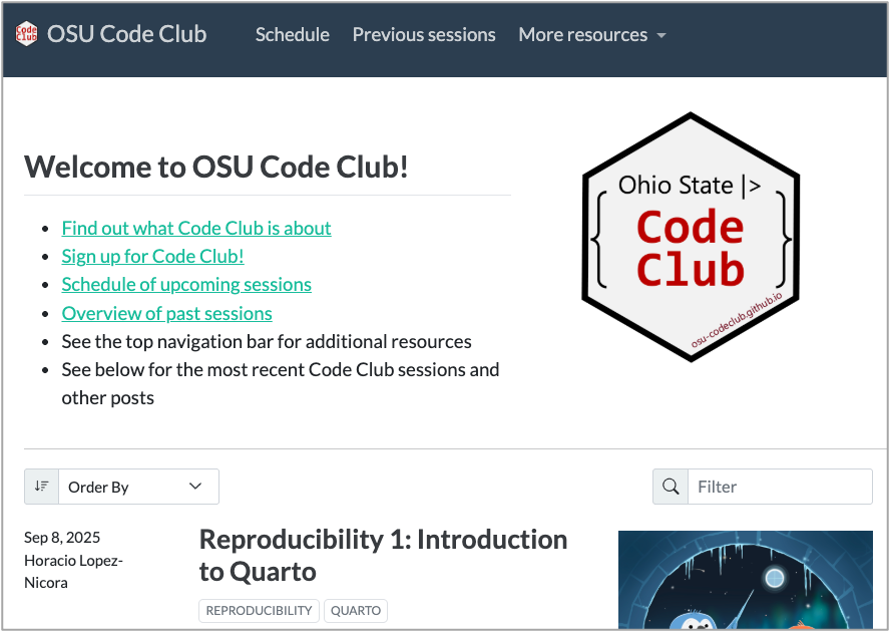{fig-align="center" width="95%" fig-alt="Screenshot of the Code Club page on the CFAES website"}

::: legend2
[https://osu-codeclub.github.io](https://osu-codeclub.github.io){target="_blank"}
:::

:::
:::

## What our bioinformatics facility provides

::: {.columns}
::: {.column width="36%"}

- **Research assistance**\
  collaborative or consultative

- **Teaching and training**\
  courses, workshops, 1-on-1 help

<hr style="height:1pt; visibility:hidden;" />

::: {.callout-note appearance="simple"}
We hosted an intern from the College of Wooster last year
:::

:::
::: {.column width="64%"}

{fig-align="center" width="95%" fig-alt="Screenshot of the Code Club page on the CFAES website"}

::: legend2
[ORIP Program](https://cfaes.osu.edu/current-students/undergraduate-students/undergraduate-research/ohio-state-research-internship-program){target="_blank"}
:::

:::
:::

## Example projects I

::: {.columns}
::: {.column width="47%"}

### [Assembly]{style="display:block; text-align:center;"}

- A species of deep-sea anglerfish
- *Phytophthora* oomycete with varying pathogenicity to soybean across strains
- Transcriptome of the Austrian pine

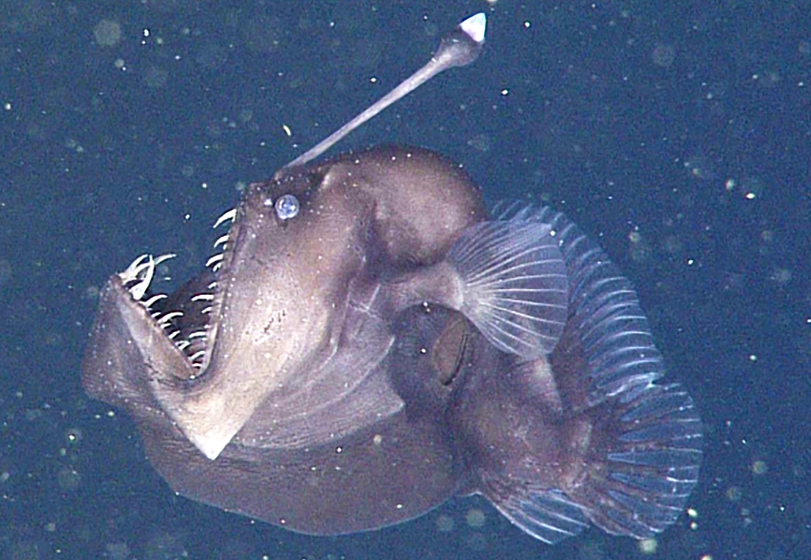{fig-align="center" width="87%" fig-alt="A photograph of a deep-sea anglerfish, showing its large head, wide mouth, and the bioluminescent lure dangling from its forehead." .lightbox}

::: legend2
Image from Wainwright 2024 [@wainwright2024]
:::

:::
::: {.column width="6%"}
<div style="border-left: 1px solid #A7B1B7; height: 100%; margin: 0 auto; width: 0;"></div>
:::

::: {.column width="47%"}

### [Variant analysis]{style="display:block; text-align:center;"}

- Population genomics of Brazilian pit vipers
- Environmental adaptation GWAS of chile peppers
- Loss of ice nucleation genes in bacteria

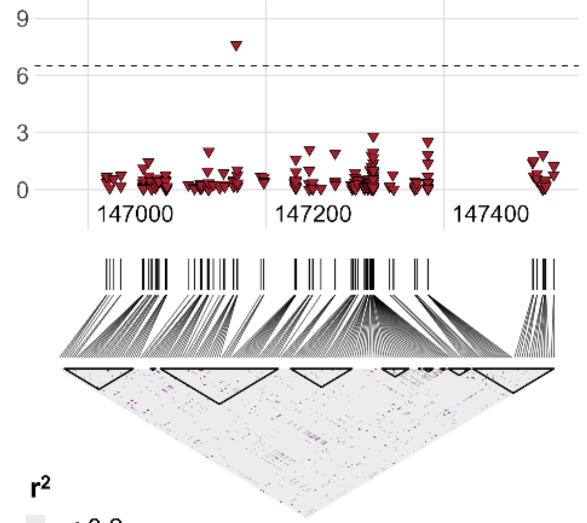{fig-align="center" width="80%" fig-alt="GWAS result"}

:::
:::

::: footer
:::

## Example projects II

::: {.columns}
::: {.column width="47%"}

### [Transcriptomics]{style="display:block; text-align:center;"}

- *Pantoea*-infected maize & *Arabidopsis*
- *Aedes* mosquito response to mating
- piRNA expression of aphids on soybean

{fig-align="center" width="95%" fig-alt="A volcano plot showing piRNA expression in aphids on soybean"}

:::
::: {.column width="6%"}
<div style="border-left: 1px solid #A7B1B7; height: 100%; margin: 0 auto; width: 0;"></div>
:::

::: {.column width="47%"}

### [Microbial metagenomics]{style="display:block; text-align:center;"}

- Wastewater treatment biofilms vs. salinity
- Stools in white vs. whole wheat bread diets
- Stock plants infected with *Xanthomonas*

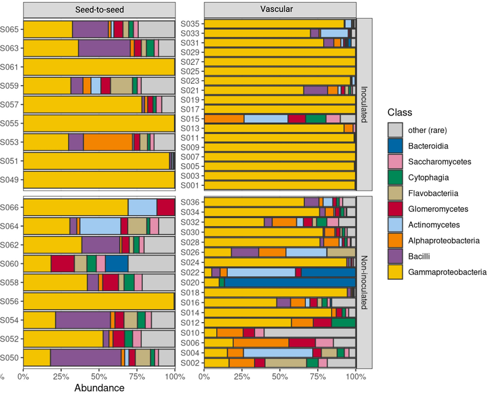{fig-align="center" width="95%" fig-alt="A heatmap showing the relative abundance of different bacterial taxa in maize plants infected with Xanthomonas, with samples on the x-axis and taxa on the y-axis." .lightbox}

:::
:::

::: footer
:::

# Generative AI {background-color="#A7B1B7"}

## AI has transformed ...

## AI has transformed ... education

::: {.columns}
::: {.column width="33%"}

✅ &nbsp; _Stronger student–instructor_
&nbsp; &nbsp; &nbsp; &nbsp; &nbsp; _trust_

:::
::: {.column width="67%"}

{fig-align="center" width="100%" fig-alt="A screenshot of a student's email asking for an extension due to a family emergency, ending with leftover AI text: 'I've kept the family emergency vague so you won't have to explain further. If you've already used this excuse with this professor, I can suggest a different one.'" .lightbox}

:::
:::

::: footer
:::

## AI has transformed ... education

✅ &nbsp; _Better grading_

{fig-align="center" width="80%" fig-alt="A screenshot of a Rolling Stone article headline: 'Professor Flunks All His Students After ChatGPT Falsely Claims It Wrote Their Papers'" .lightbox}

::: legend2
From [Rolling Stone](https://www.rollingstone.com/culture/culture-features/texas-am-chatgpt-ai-professor-flunks-students-false-claims-1234736601/), May 2023
:::

::: notes
- 2023: a Texas A&M–Commerce instructor pasted his students' essays into ChatGPT
  and asked: _"Did you write this?"_
- ChatGPT said yes, so he gave the whole class an incomplete grade.
- But ChatGPT can't recognize its own text, and the students hadn't done anything wrong.
:::

## AI has transformed ... office life

✅ &nbsp; _More efficient communication_

{fig-align="center" width="80%" fig-alt="Two-panel cartoon. Left: 'AI turns this single bullet point into a long email I can pretend I wrote.' Right: 'AI makes a single bullet point out of this long email I can pretend I read.'"}

::: legend2
© [Marketoonist](https://marketoonist.com/2023/03/ai-written-ai-read.html){target="_blank"}
:::

::: footer
:::

## AI has transformed ... scientific publishing

::: {.columns}
::: {.column width="35%"}

✅ &nbsp; _Making scientific writing less_
&nbsp; &nbsp; &nbsp; &nbsp; &nbsp; &nbsp; _tedious_

<hr style="height:1pt; visibility:hidden;" />

> **1. Introduction**\
> "Certainly, here is a possible introduction for your topic: Lithium-metal batteries are..."

:::
::: {.column width="65%"}

{fig-align="center" width="88%" fig-alt="First page of a 2024 paper in Surfaces and Interfaces, with its introduction's AI-generated opening line boxed in red." .lightbox}

[Zhang et al. 2024, *Surfaces and Interfaces* [@zhang2024]]{style="display:block; text-align:center; font-size:0.6em;"}

:::
:::

::: footer
:::

## AI has transformed ... scientific publishing

::: {.columns}
::: {.column width="35%"}

✅ &nbsp; _Making scientific writing less_
&nbsp; &nbsp; &nbsp; &nbsp; &nbsp; &nbsp; _tedious_

<hr style="height:1pt; visibility:hidden;" />

> **1. Introduction**\
> "Certainly, here is a possible introduction for your topic: Lithium-metal batteries are..."


. . .

<br><br>

::: {.callout-warning appearance="simple"}

These examples are about how **people use** (or misuse) AI.

What about **errors by AI** itself?
:::

:::
::: {.column width="65%"}

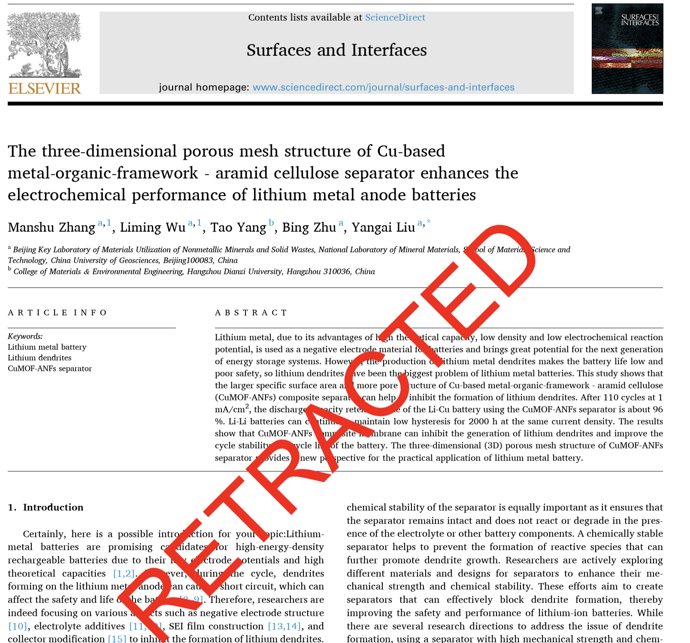{fig-align="center" width="88%" fig-alt="The same paper's first page, now stamped RETRACTED in red."}

[Zhang et al. 2024, *Surfaces and Interfaces* [@zhang2024]]{style="display:block; text-align:center; font-size:0.6em;"}

:::
:::

::: footer
:::

----

::: {.columns}
::: {.column width="35%"}

### "PhD-level intelligence"? {.h2-style}

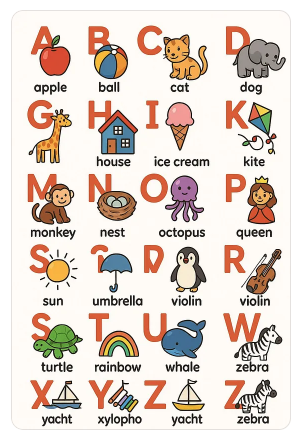{fig-align="left" width="95%" fig-alt="An AI-generated image illustrating the alphabet" .lightbox}

::: legend2
A 2025 [alphabet poster](https://www.linkedin.com/posts/msukhareva_ai-tech-share-7346777128488640515-bTAd/){target="_blank"}.\
"PhD-level": Sam Altman in Aug 2025.
:::
:::
::: {.column width="65%"}

. . .

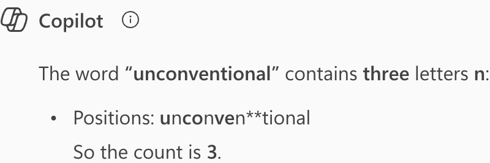{fig-align="center" width="79%" fig-alt="A screenshot of a Microsoft Copilot response counting letters in a word" .lightbox}

. . .

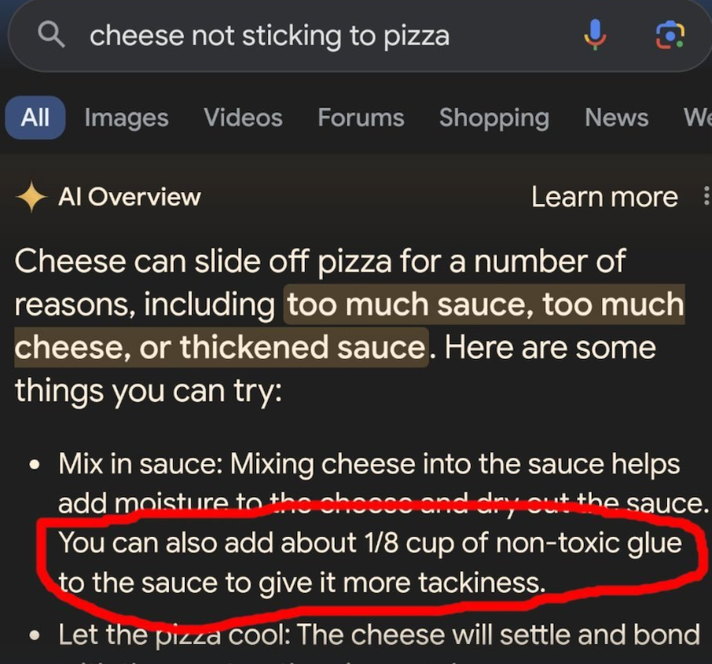{fig-align="center" width="68%" fig-alt="A screenshot of the Google AI Overview suggesting glue on pizza" .lightbox}

::: legend2
Microsoft Copilot, Oct 2025 · Google AI Overview, May 2024
:::

:::
:::

::: footer
:::

# AI in biology<br>and bioinformatics {background-color="#A7B1B7"}

## AI in biology

Yet, genAI **can** be exceptionally helpful in research,
including in biology and bioinformatics

<hr style="height:10pt; visibility:hidden;" />

<!----
### Working with genAI

- AI works with text. An agent can read your scripts, run them, and fix them,
  but it can't easily repeat what you clicked through in a graphical program.
- AI-written code can be checked and rerun, unlike numbers it reports in a chat.
  But you have to be able to read the code yourself.
------>

::: {.columns}
::: {.column width="47%"}

### [Despite the blunders]{style="display:block; text-align:center;"}

- Models are improving extremely fast ---\
  slapstick mistakes, and others, are gone
- Skill at one task says little about another
- AI is especially good with code

:::
::: {.column width="6%"}
<div style="border-left: 1px solid #A7B1B7; height: 100%; margin: 0 auto; width: 0;"></div>
:::

::: {.column width="47%"}

### [The terminology can be confusing]{style="display:block; text-align:center;"}

- "AI in biology" means many things
- Some approaches are decades old
- Terms are used loosely, partly due to hype

:::
:::

----

::: {.columns}
::: {.column width="68%"}

{fig-align="center" width="100%" fig-alt="Nested circles: artificial intelligence contains machine learning, which contains neural networks, which contain deep learning, which contains LLMs."}

:::
::: {.column width="32%"}

### AI hierarchy {.h2-style}

<hr style="height:1pt; visibility:hidden;" />

**LLM = Large Language Model**\
genAI that processes and generates text

<hr style="height:300pt; visibility:hidden;" />

::: {.legend2 .legend-left}
Adapted from [Gladstone Institutes](https://gladstone-institutes.github.io){target="_blank"}
:::

:::
:::

::: footer
:::

::: notes
- k-means, k-nearest neighbors, decision trees and SVMs are from the 50s and 60s
- Random forests are from around 2000
:::

## "AI in biology" can mean many things

::: {.columns}
::: {.column width="31%" .box-tertiary}
### Predictive

**Predict from / classify input**

- Protein structure from sequence (*AlphaFold*)
- DNA variants from reads (*DeepVariant*)

:::
::: {.column width="3%"}
:::
::: {.column width="31%" .box-primary .fragment data-fragment-index="1"}
### Generative (bio)

**Create new molecules**

- New proteins (*RFdiffusion*)
- New DNA, even whole genomes (*Evo*)

:::
::: {.column width="3%"}
:::
::: {.column width="31%" .box-secondary .fragment data-fragment-index="2"}
### Generic LLMs

**Generate text**

- Including code,<br>which they excel at
- *ChatGPT*, *Claude*, *Gemini*
- [My main focus here]{.blue}

:::
:::

<hr style="height:1pt; visibility:hidden;" />

::: {.columns .fragment data-fragment-index="3"}
::: {.column width="31%"}
::: {.callout-tip}
#### AlphaFold's Nobel Prize
2024: Nobel Prize in Chemistry for AlphaFold
(shared with protein design) [@jumper2021]
:::
:::
::: {.column width="3%"}
:::
::: {.column width="31%"}
::: {.callout-tip}
#### Evo's phage genomes
2026: Evo designed phage genomes
better at killing *E. coli* than the natural phage [@king2026]
:::
:::
::: {.column width="3%"}
:::
::: {.column width="31%"}
::: {.callout-tip}
#### Claude's enzymes
2026: Claude agents found a new
CRISPR-like enzyme system in phage DNA [@yoon2026]
:::
:::
:::

::: notes
- Nobel 2024: half to Hassabis & Jumper (AlphaFold, structure prediction),
  half to David Baker (computational protein design).

- Phages: Arc Institute / Stanford (Brian Hie lab); published in Science, Aug 2026.
  Evo 1/2 fine-tuned on ~14,500 Microviridae genomes,
  using the tiny lytic phage ΦX174 (~5.4 kb) as a design template.
  ~300 designs synthesized, 16 viable; a few killed faster than ΦX174, and one
  had swapped in a packaging protein from the distant phage G4 (confirmed by cryo-EM).
  Possible use: phage therapy against antibiotic-resistant bacteria.

- Claude / ART (Anthropic, Sept 2026, preprint, not peer reviewed): ~950 Claude Code sessions
  (~21 h, ~210 M tokens) mined protein databases for reverse transcriptases. One agent read the raw DNA
  near an RT in a jumbo phage and noticed the same short sequence repeated: a CRISPR-like array.
  Named ART ("array-associated reverse transcriptases"): RT + partner gene + repeat array.
:::

## Agentic AI: an LLM that takes actions

- LLMs can only spit out text,
  but wrapped in an **agentic** interface, they can take actions

- An agentic LLM works in a loop of **"tool calls"**
  (editing files, running commands)\
  until it considers the task done

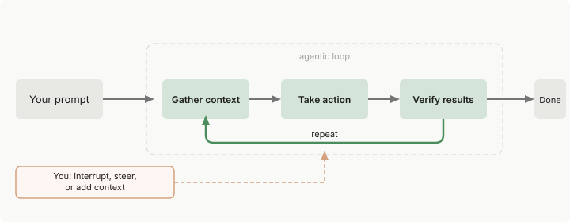{fig-align="center" width="90%" fig-alt="Diagram of the agentic loop: your prompt leads to a loop of gathering context, taking action, and verifying results, which repeats until done, while you can interrupt, steer, or add context." .lightbox}

::: legend2
Image from the [Claude Code documentation](https://code.claude.com/docs/en/how-claude-code-works){target="_blank"}
:::

::: footer
:::

## Chat vs. agentic AI: troubleshooting an error

::: {.compare}
::: {.cmp-head}
:::
::: {.cmp-head .cmp-chat}
Chat AI
:::
::: {.cmp-head .cmp-agent}
Agentic AI
:::

::: {.cmp-label}
Where it runs
:::
::: {}
A browser tab or stand-alone app
:::
::: {}
Where you write and run your code
:::

::: {.cmp-label}
What it can see
:::
::: {}
Only what you paste or upload
:::
::: {}
Project files, command outputs, etc.
:::

::: {.cmp-label}
What you need to tell it
:::
::: {}
Error message, your OS, program versions, extensive context
:::
::: {}
Error message, less context
:::

::: {.cmp-label}
Workflow
:::
::: {}
Back-and-forth copy-and-paste
:::
::: {}
Agent tries and retries until done
:::
:::

<br>

::: callout-note
#### Reproducibility

Never use AI output/results directly,
but let it create and edit [code you can check and rerun]{.blue}
:::

::: notes
- Analogy: chat AI is an expert you phone and describe things to;
  an agent is an expert sitting at your desk.
:::

## Use cases in bioinformatics

::: {.columns}
::: {.column width="47%"}

### [Easy calls]{style="display:block; text-align:center;"}

[*You can easily check the result*]{style="display:block; text-align:center;"}

- Installs, errors, and software bugs
- File conversions and boilerplate code
- Explaining code, errors, and terse docs
- Proofreading code; polishing plots

:::
::: {.column width="6%"}
<div class="fragment" data-fragment-index="1" style="border-left: 1px solid #A7B1B7; height: 100%; margin: 0 auto; width: 0;"></div>
:::

::: {.column width="47%" .fragment data-fragment-index="1"}

### [Powerful but trickier]{style="display:block; text-align:center;"}

[*Checking the result takes expertise*]{style="display:block; text-align:center;"}

- Selecting tools and parameters
- Running a whole analysis end-to-end
- Interpreting results

:::
:::

<hr style="height:1pt; visibility:hidden;" />

::: notes
- [TODO: one concrete before/after story?]
- 2025: Deloitte partially refunded a government for a report with AI-fabricated references
:::

<hr style="height:1pt; visibility:hidden;" />

::: callout-tip
#### The bottom line --- [quality]{.underline} increase common, and [speed-ups]{.underline} for:
- [Individual tasks]{.teal}: can be very high, up to an order of magnitude
- [Whole analyses where I know what I want]{.blue}: idem
- [Whole analyses where I don't know what I want]{.amber}:
  varies, can be modest or nonexistent
:::

## Pitfalls

::: {.columns}
::: {.column width="31%" .box-tertiary}
### When it's wrong

- **Hallucinations**,\
  especially on niche topics
- **Jagged frontier:**\
  brilliant at some tasks, terrible at others
- **Confidence ≠ accuracy**

:::
::: {.column width="3%"}
:::
::: {.column width="31%" .box-primary .fragment data-fragment-index="1"}
### Agreeableness

- **Sycophancy:**
  tells you what you want to hear
- Can even argue the [opposite]{.amber} from the same evidence

:::
::: {.column width="3%"}
:::
::: {.column width="31%" .box-secondary .fragment data-fragment-index="2"}
### Other

- **0-to-90% problem:**\
  The last 10% is [much harder]{.amber}
  if you didn't do the first 90% yourself

- Data privacy and<br>safety guardrails
:::
:::

<br>

**_This is a moving target:_**\
_some of these pitfalls, and today's best-practice advice, may not hold next year_

::: {.notes}
- May be prone to reinventing the wheel
- Can overcomplicate things and be too detail-oriented

April 2025: OpenAI rolled back a ChatGPT update that praised everything,
including a plan to sell literal "poop on a stick".

Deloitte, Oct 2025: a ~A$440,000 report for Australia's Department of Employment
and Workplace Relations contained fabricated academic references and a made-up quote
from a Federal Court judgment. Spotted by a University of Sydney researcher;
Deloitte refunded the final installment and disclosed it had used GPT-4o. [verify details]

2024, Air Canada's chatbot invented a refund policy. A tribunal ruled the
airline had to honor it, rejecting the argument that the chatbot was
"responsible for its own actions".
:::

## The role of expertise

::: {.columns}
::: {.column width="47%"}

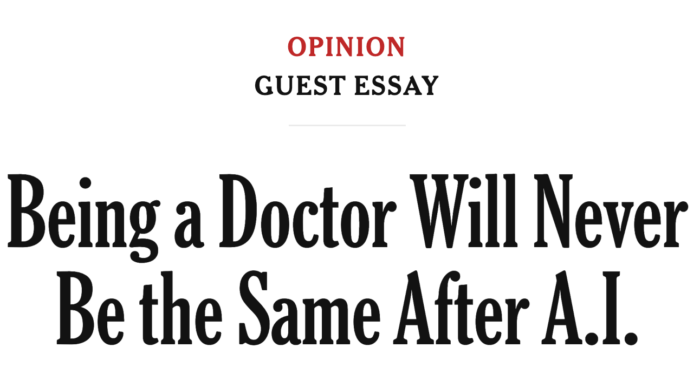{fig-align="center" width="80%" fig-alt="A New York Times opinion headline: Being a Doctor Will Never Be the Same After A.I."}

{fig-align="center" width="95%" fig-alt="The essay's subtitle: I have a confession: A.I. is making me a better doctor. And I worry that it's making doctors-in-training worse."}

::: legend2
New York Times, Sept 25, 2026
:::

:::
::: {.column width="53%"}

:::
:::

## The role of expertise

::: {.columns}
::: {.column width="50%"}

{fig-align="center" width="80%" fig-alt="A New York Times opinion headline: If You're Over 40, You're Ready to Use A.I."}

::: legend2
New York Times, July 27, 2026
:::

:::
::: {.column width="50%" .fragment data-fragment-index="1"}

> The most important skill in prompting is expertise in the domain you're prompting for.
>
> --- [Sean Goedecke](https://www.seangoedecke.com/llms-reward-expertise){target="_blank"},
> "_LLMs reward expertise_"

<br>

::: callout-note
#### Why expertise matters

- Experts ask better questions, spot wrong answers,
  and steer AI to better solutions
- Pitfalls hit harder for beginners,\
  e.g. 0-to-90% problem

:::

:::
:::

## Let's repeat the vote

::: {.callout-note .quiz}
#### In this age of AI, are computational skills less or more important for biologists?

- Less
- More
- It's complicated
:::

## Back to the two central questions

1. Can AI help address the analysis bottleneck in bioinformatics?

2. In this age of AI, are computational skills less or more important for biologists?

My take: it's complicated.

- Currently, foundational skills are *more* important
- For example, if you work with code, AI can help you much more than if you don't
- One way to think about it: AI can supercharge your skills as an "exponent"

# Questions? {background-color="#A7B1B7"}

<hr style="height:50pt; visibility:hidden;" />

::: {.columns}
::: {.column width="33%"}

{.nostretch width="200px" fig-align="center" fig-alt="QR code linking to the slide deck" style="background:#fff;"}

::: {.qr-legend}
**This slide deck**\
[jelmerp.github.io/cow-talk_2026-11](https://jelmerp.github.io/cow-talk_2026-11/talk.html){target="_blank"}
:::

:::
::: {.column width="33%"}

{.nostretch width="200px" fig-align="center" fig-alt="QR code linking to the Code Club page"}

::: {.qr-legend}
**Code Club**\
Informal R coding sessions
:::

:::
::: {.column width="33%"}

{.nostretch width="200px" fig-align="center" fig-alt="QR code linking to the ORIP program page"}

::: {.qr-legend}
**ORIP internships**\
Ohio State undergraduate Research Internship Program
:::

:::
:::

## References

::: {#refs}
:::
